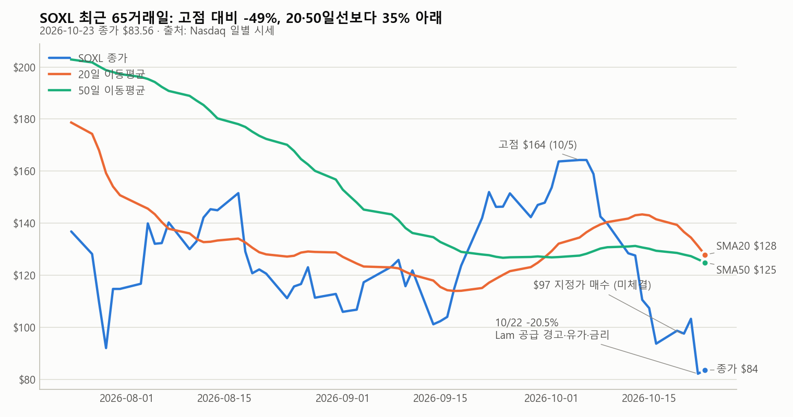
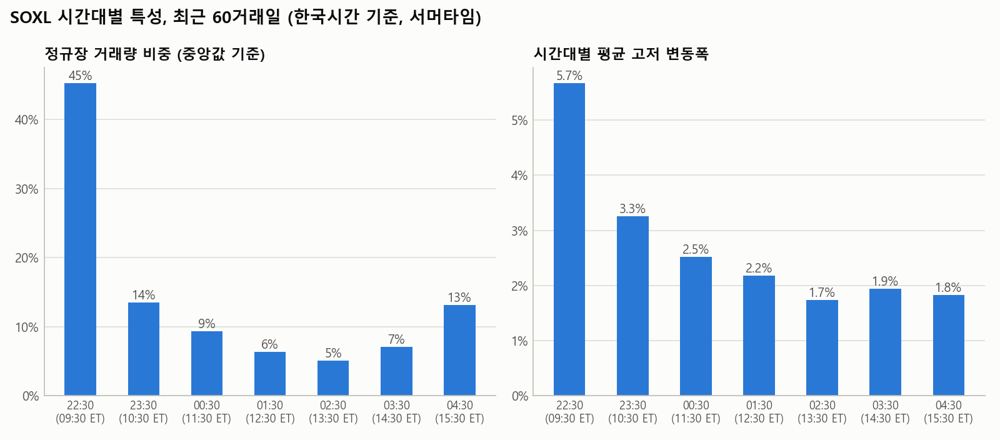
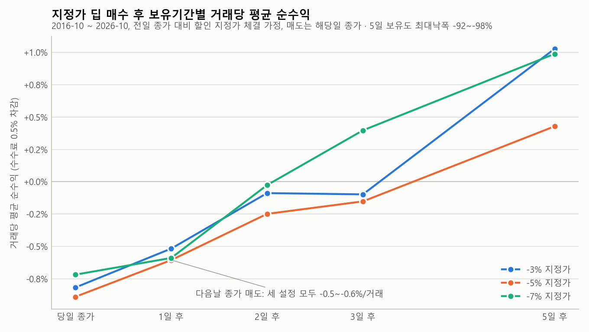
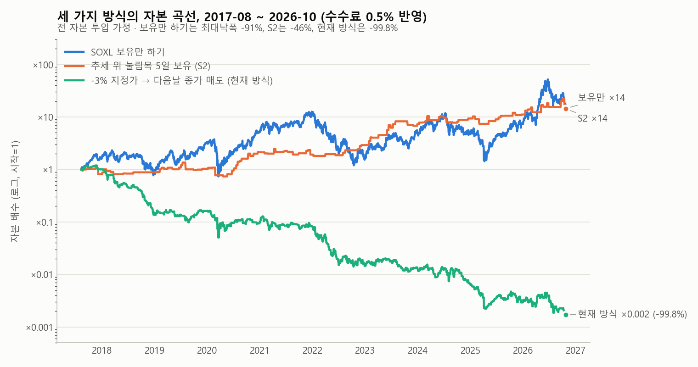

# SOXL 단기 트레이드 연구 — 2026-10-24

**질문:** 잔고 $8,218.70(10,886,489원), 왕복 매매 수수료 0.5%. 급락 뒤 단기 트레이드를 어떻게 할 것인가.
**방법:** SOXL 10년 일봉(2016-10-24~2026-10-23, 2,514거래일)과 최근 60거래일 시간봉으로 수수료 0.5%를 반영한 백테스트를 돌리고, 급락 원인과 다음 주 일정을 조사했습니다.
**기준 시각:** 2026-10-24(토) KST. 가격 데이터는 2026-10-23(금) 미국 정규장 종가까지입니다.

이 문서는 연구 기록이지 매매 지시가 아닙니다. 모든 백테스트는 과거 데이터에 대한 사후 분석이며, 아래 "한계" 절을 먼저 읽는 것을 권합니다.

## 0. 한눈에 보는 결론

1. **수수료 0.5%는 SOXL 변동성에 비하면 작습니다.** SOXL의 하루 등락 절대값 중앙값은 3.44%(10년), 5.30%(최근 1년)입니다. 수수료는 하루 고저 범위(중앙값 6~8%)의 1/12~1/16입니다. 계좌가 19% 줄어든 원인은 수수료가 아니라 **엣지 없는 매매 + 3배 레버리지 + 전 자본 투입**의 조합입니다.
2. **현재 방식(전일 종가보다 3~5% 낮은 지정가 매수 → 다음 날 매도)은 10년 데이터에서 기대값이 없습니다.** 수수료 0에서도 거래당 -0.02~-0.11%, 수수료 0.5% 반영 시 **-0.5~-0.6%**, 승률 46~48%, 전 자본 투입 시 누적 -100%입니다. 2026년 10월에는 -3% 지정가가 8번 체결돼 6번 손실(누적 약 -25%)이었습니다.
3. **살아남은 규칙은 두 가지**이고 둘 다 한국시간 22:30 미국 개장 직후에 실행할 수 있습니다.
   - **S2 눌림목:** 종가가 20일선 위이고 2거래일 하락폭이 3% 이상 → 다음 날 개장가 매수 → 5거래일 뒤 개장가 매도. 10년간 111회(연 11회), 승률 66%, 거래당 **+3.2%**, 수익/손실비 1.94, 최대낙폭 -46%.
   - **급락 반등:** 하루 -10% 이상 → 다음 날 개장가 매수 → 그 다음 날 개장가 매도. 115회, 승률 56%, 거래당 **+1.6%**(20일선 아래일 때 +1.9%), 최대낙폭 -30~-33%.
4. **지금은 S2 신호가 없습니다.** 10/23 종가 $83.56은 20일선($127.85)보다 34.6% 아래입니다. 과거 -20% 급락 뒤 20일선을 되찾기까지 2020·2024·2025년에는 **9~21거래일** 걸렸습니다.
5. **포지션 크기가 생존을 결정합니다.** 한 번에 자본의 1/3 이하(현재가 기준 약 32주, $2,674)만 쓰면 하루 -20%가 와도 계좌의 -6.5%입니다. 전량 98주면 -20%입니다.
6. **빈도는 주 2회 이하, 거래당 목표는 수수료의 10배인 +5% 이상.** 하루 1회 왕복은 연 125%의 수수료를 내는 구조입니다.
7. **정보가 나오는 시간에 움직여야 합니다.** 10/22 급락은 한국시간 06:00 Lam Research 컨퍼런스콜에서 시작해 22:30 개장까지 16시간 동안 $103 → $90로 서서히 진행됐습니다. 애프터마켓·주간거래·프리마켓이 모두 열려 있었습니다.

## 1. 현재 상황

### 1.1 계좌 변화, 사용자 제공값

| 시점 | 달러 | 원화 표시 | 비고 |
| --- | ---: | ---: | --- |
| 10/21 00:40 KST 시작 기록 | $10,208.14 | 13,598,262원 | $97 × 105주 지정가 매수, 미체결 |
| 10/21 한국장 마감 | $10,119.69 | 13,438,949원 | 추가 거래 내역 미제공 |
| 10/24 이번 기록 | **$8,218.70** | **10,886,489원** | 잔액 종류(현금/총자산) 미확인 |
| 10/21 시작 대비 | -$1,989.44 (-19.49%) | -2,711,773원 (-19.94%) | |
| 10/21 마감 대비 | -$1,900.99 (-18.78%) | -2,552,460원 (-18.99%) | |

원화/달러 비율로 역산한 환율은 10/21 시작 1,332.1원, 10/21 마감 1,328.0원, 10/24 1,324.6원입니다.

**보유 추정:** SOXL은 10/21 종가 $103.24에서 10/23 종가 $83.56으로 **-19.06%** 움직였습니다. 잔액 변동 -18.78%와 거의 같으므로, 10/21 종가 부근에서 SOXL을 거의 전량 보유한 채 10/22 급락을 맞은 것으로 추정합니다. 보유 수량·평균단가·현재 현금은 미확인이며, 이 추정이 틀리면(현금 보유 중) 7절의 "보유 중이라면"만 건너뛰면 됩니다.

### 1.2 SOXL 가격 경로, Nasdaq 일별 시세



| 날짜(미국) | 시가 | 고가 | 저가 | 종가 | 등락 | 비고 |
| --- | ---: | ---: | ---: | ---: | ---: | --- |
| 10/05 | 161.66 | 164.38 | 158.08 | **164.27** | +0.34% | 최근 60거래일 고점 |
| 10/08 | 150.48 | 155.50 | 136.32 | 142.52 | -10.31% | 거래량 1.02억 |
| 10/14 | 119.02 | 120.90 | 109.00 | 110.54 | -13.35% | |
| 10/16 | 101.18 | 103.93 | 93.44 | 93.67 | -12.74% | |
| 10/19 | 103.95 | 104.98 | 97.80 | 98.65 | +5.32% | |
| 10/20 | 94.52 | 102.62 | 91.35 | 97.55 | -1.12% | 사용자 $97 주문 세션으로 추정, 미체결. 저가 91.35는 주문 시각(11:40 EDT) 이전 오전 구간으로 추정 |
| 10/21 | 102.86 | 106.13 | 99.31 | 103.24 | +5.83% | 장 마감 후 Lam Research 실적 |
| 10/22 | 90.59 | 93.40 | 80.22 | **82.11** | **-20.47%** | 거래량 1.81억, 10년 중 14번째 큰 하락 |
| 10/23 | 81.64 | 87.61 | 80.83 | **83.56** | +1.77% | |

- 10/5 고점 대비 **-49.1%**. 10/8~10/14 한 주에 -30.4%, 10/15~16 이틀 -15.3%(머니투데이 집계)였고 10/22가 다시 -20.5%였습니다.
- 10/23 기준 20일선 $127.85(-34.6%), 50일선 $124.87(-33.1%), 200일선 $123.20(-32.2%). 세 이동평균이 거의 같은 자리에 겹쳐 있습니다.
- 20일 실현변동성은 연율 **114%**로, 10년 중앙값 87%보다 높고 상위 10% 경계(142%)에는 못 미칩니다.

### 1.3 급락 원인, 보도 기준

| 요인 | 내용 | 출처 |
| --- | --- | --- |
| Lam Research 실적 콜(10/21 장 마감 후) | CEO Tim Archer: 특정 부품 공급망 제약이 2027년까지 지속, 고객 수요 충족 제한. CFO: 공급 제약으로 매출 전망 하향, 약 $3~4억 매출이 3월로 이연. LRCX -11.8% | Stocktwits/Yahoo, 24/7 Wall St, Arabian Post |
| 업종 전체 | 필라델피아 반도체지수(SOX) -6.72%, 30종목 전부 하락. NVDA -4.4%($212.21), MU -6% 이상, AMD·MRVL -8%, INTC -7% | 동일 |
| 젠슨 황 발언 | CNBC 인터뷰(GTC Berlin): 네오클라우드(CoreWeave, Nebius 등)의 운전자본 부족 언급. 수요는 "off the charts"라고 했지만 자금 조달 우려를 키움 | Investing.com, TradingKey |
| 유가·지정학 | 브렌트 $116 상회, WTI $103(금요일 +4%). 중간선거 뒤 미·이란 충돌 재개 우려 | TheStreet Pro |
| 금리 | 미 10년물 약 5.0%. 10월 FOMC 동결 확률 약 91%, 12월까지 **인상** 확률 약 78%로 시장이 가격 반영 | TheStreet Pro |
| 주간 흐름 | SOX 주간 -3.2%(3주 연속 하락), 나스닥 -0.7%, S&P500 -0.5%, 러셀2000 +2%. 금요일 SOX +0.4%로 약한 반등 | TheStreet Pro |

### 1.4 10/22 급락의 시간 순서, 한국시간

| KST | 미국시간 | 세션 | SOXL | 비고 |
| --- | --- | --- | ---: | --- |
| 10/22 05:00 | 10/21 16:00 | 정규장 마감 | 103.24 | |
| 10/22 06:00 | 10/21 17:00 | Lam 컨퍼런스콜 시작 | | |
| 10/22 05:00~09:00 | 10/21 16:00~20:00 | 애프터마켓 | 저가 98.00, 09:00 KST 98.50 | 이미 -4.6% |
| 10/22 09:00~17:00 | 10/21 20:00~10/22 04:00 | 주간거래(Blue Ocean) | 98.5 → 92.8 부근 | Yahoo 데이터 없음, 양끝 가격으로 추정 |
| 10/22 17:00~22:30 | 10/22 04:00~09:30 | 프리마켓 | 92.80 → 89.52(저가 89.51) | |
| 10/22 22:30 | 10/22 09:30 | 정규장 개장 | 90.59 | 갭 -12.25% |
| 10/22 23:30 / 01:00 / 03:00 | 10:30 / 12:00 / 14:00 | 정규장 | 87.46 / 85.82 / 82.79 | 하루 종일 하락 |
| 10/23 05:00 | 10/22 16:00 | 마감 | 82.11 | -20.47% |

하락은 한 번의 갭이 아니라 **16시간 넘게 이어진 경사**였습니다. 애프터마켓·주간거래·프리마켓 어느 창구에서든 $98~$90에 매도할 수 있었습니다. 7절의 "정보 규칙"은 여기서 나왔습니다.

### 1.5 국내 수급과 주간거래 제한

- 머니투데이 서학픽(10/19 07:05): 10/8~14 국내 투자자 SOXL 순매수 **약 25.76억 달러(약 3.4조 원)**, 같은 기간 SOXL -30.4%. 미국 주식 전체 순매수(25.17억 달러)보다 SOXL 한 종목이 많았습니다.
- 한경비즈니스(10/21, 이 저장소 news N06): 10/7~19 국내 미국 주식 순매수의 98.4%(약 5.43조 원)가 SOXL.
- Stocktwits 집계(10/23): -20% 당일에도 SOXL 개인 심리는 "extremely bullish". 반대 지표로 읽을 수 있습니다. 쏠린 매수는 반등 시 매물로 돌아옵니다.
- **주간거래 제한 이력:** Blue Ocean ATS는 8/31(미 동부 20:00)부터 SOXL 포함 18종목의 주간거래를 중단했고(SEC Fair Access Rule, 단일 ATS 거래량이 6개월 중 4개월 일평균의 5% 초과), 9/10 시세를 재개했지만 9/11 일부 종목이 다시 기준을 넘어 중단됐습니다(뉴스핌 9/2, 조선비즈 9/16). **10월 현재 상태는 보도로 확인하지 못했습니다.** 증권사 공지를 확인하고, 주간거래를 비상 탈출구로만 쓰는 것이 안전합니다.

## 2. 수수료 0.5%가 뜻하는 것

**손익분기:** 왕복 0.5%(편도 0.25% 가정)이면 매도가가 매수가보다 **+0.50%** 높아야 본전입니다. 식은 (1+0.0025)/(1-0.0025) = 1.00501입니다.

**변동성 대비:** 수수료가 작아 보이는 이유입니다.

| 기간 | 하루 등락 표준편차 | 하루 등락 절대값 중앙값 | 하루 고저 범위 중앙값 | 등락 10% 초과일 비중 | 최악의 날 |
| --- | ---: | ---: | ---: | ---: | ---: |
| 10년 | 6.51% | 3.44% | 5.96% | 10.5% | -38.6% (2020-03-16) |
| 최근 3년 | 7.47% | 4.01% | 6.60% | 14.1% | -30.5% (2026-06-05) |
| 최근 1년 | 8.63% | 5.30% | 8.07% | 23.2% | -30.5% |
| 최근 60일 | 7.36% | 4.30% | 7.43% | 15.0% | -20.5% |

**빈도가 문제입니다.** 수수료는 거래당이 아니라 연간으로 쌓입니다.

| 매매 빈도 | 포지션 금액 대비 연간 수수료 |
| --- | ---: |
| 하루 1회 왕복 | 125% |
| 주 3회 | 78% |
| 주 1회 | 26% |
| 월 2회 | 12% |
| 월 1회 | 6% |

**손익분기 승률.** 평균 수익 G%, 평균 손실 L%일 때 필요한 승률은 (L + 0.5) / (G + L)입니다.

| G / L | 수수료 없을 때 | 수수료 0.5% |
| --- | ---: | ---: |
| 2% / 2% | 50.0% | 62.5% |
| 3% / 3% | 50.0% | 58.3% |
| 5% / 5% | 50.0% | 55.0% |
| 8% / 8% | 50.0% | 53.1% |
| 6% / 3% | 33.3% | 38.9% |
| 10% / 5% | 33.3% | 36.7% |

이 표가 말하는 것: 2~3% 짜리 짧은 수익을 노리면 승률 60% 이상이 필요한데, 백테스트에서 SOXL 단기 매매의 승률은 45~55%였습니다. **거래당 목표를 5% 이상으로 키우는 것**이 수수료를 이기는 유일한 현실적 방법입니다.

**1배 ETF와의 비교.** 같은 반도체 노출을 SOXX(1배)로 잡으면 명목금액이 3배라 수수료도 3배입니다. SOXL로 자본의 1/3만 사면 SOXX 전량과 노출이 비슷하고 수수료는 1/3입니다. 일주일 이내 보유라면 3배 ETF의 변동성 잠식(일간 리밸런싱 비용)은 수수료에 비해 작습니다. 레버리지 자체가 아니라 **전량 투입**이 위험의 원천이라는 뜻입니다.

**세금.** 해외주식 양도차익은 연 250만 원 초과분에 22%가 과세됩니다. 단기 매매 수익도 같습니다. 같은 해 실현 손실은 이익과 상계되므로, 올해 손실을 확정하는 것은 올해 남은 기간의 이익에 대한 세금 완충이 됩니다.

## 3. 데이터로 본 SOXL의 성격

### 3.1 수익은 밤에, 변동은 낮에

| 기간 | 오버나이트(종가→다음 시가) 하루 평균 | 누적 | 장중(시가→종가) 하루 평균 | 누적 |
| --- | ---: | ---: | ---: | ---: |
| 10년 | +0.27% | **+10,613%** | +0.07% | **-75%** |
| 최근 3년 | +0.45% | +1,075% | +0.06% | -52% |
| 최근 1년 | +0.55% | +140% | +0.10% | -19% |

SOXL의 10년 상승은 전부 밤(미국 장 마감~다음 개장) 사이에 났고, 장중만 보유했으면 자본이 1/4로 줄었습니다. 평균이 +0.07%여도 변동성이 커서 복리로는 깎입니다. 데이 트레이드(당일 매수·당일 매도)가 백테스트에서 가장 나쁜 변형(거래당 -0.7~-1.0%)이었던 이유입니다. 다만 오버나이트의 하루 평균 +0.27~0.55%도 수수료 0.5%와 비슷한 크기라, **매일 왕복하면 밤 수익도 수수료에 다 먹힙니다.**

### 3.2 이동평균 아래에서는 꼬리가 세 배 두꺼워집니다

| 기준 | 다음 날 평균 | 다음 날 표준편차 | -15% 이하인 날 비중 | +10% 이상인 날 비중 |
| --- | ---: | ---: | ---: | ---: |
| 20일선 위 (59%의 날) | +0.20% | 5.6% | 1.1% | 3.4% |
| 20일선 아래 (41%) | +0.54% | 7.7% | 2.6% | 7.3% |
| 50일선 위 (60%) | +0.29% | 5.5% | **0.9%** | 3.4% |
| 50일선 아래 (40%) | +0.42% | 7.9% | **3.0%** | 7.5% |

10년간 -15% 이하였던 43일 중 27일은 전날 종가가 20일선 아래, 29일은 50일선 아래였습니다. 이동평균 아래는 평균 수익이 더 높지만 양쪽 꼬리가 모두 두껍습니다. **지금이 그 구간입니다.**

### 3.3 큰 하락 다음에는

| 조건(하루 등락) | 표본 | +1일 | +3일 | +5일 | +10일 | +20일 |
| --- | ---: | --- | --- | --- | --- | --- |
| -10% 이하 | 138 | 평균 +2.3%, 승률 64% | +1.4%, 50% | +3.1%, 55% | +5.1%, 57% | +9.8%, 55% |
| -15% 이하 | 43 | +2.9%, 72% | +0.5%(중앙값 -1.0%), 45% | +2.5%, 55% | +6.0%, 55% | +7.2%, 55% |
| -20% 이하 | 14 | +3.9%, 79% | **-3.9%(중앙값 -6.8%), 38%** | -3.2%, 38% | +5.2%, 62% | +14.3%, 69% |

다음 날 반등은 흔하고(10/23 +1.77%가 그것), **2~5일차에 다시 약해지는 경우가 많으며**, 2~4주 뒤에는 평균적으로 회복했습니다. 표본 14개의 중앙값이므로 방향 참고용이지 확률이 아닙니다. 2020년 3월에는 -20% 다음 더 -57%까지 밀린 경로도 포함돼 있습니다.

-20% 이하 하락 뒤 20일선 회복까지 걸린 기간: 2020-03 13~20거래일, 2024-07/08/09 10~21거래일, 2025-01/04 9~15거래일, 2026-06 1~2거래일(V자). 회복 전 저점은 급락일 종가 대비 -1.6%에서 -56.9%까지 흩어졌습니다.

### 3.4 시간대별 특성, 최근 60거래일 시간봉



- 정규장 첫 1시간(22:30~23:30 KST)에 하루 정규장 거래량의 **45%**가 몰리고, 하루 고저 범위의 중앙값 **75%**가 만들어집니다.
- 그 뒤 시간대는 거래량 5~14%, 시간당 변동폭 1.7~3.3%입니다. 마지막 1시간(04:30 KST)에 거래량이 13%로 다시 늘지만 사용자는 자는 시간입니다.
- 프리마켓·애프터마켓 시간봉은 변동폭이 1~4%인데 거래량 정보가 없습니다(Yahoo 데이터 한계). 호가가 얇다는 뜻이며, 이 시간대 시장가 주문은 피해야 합니다.

## 4. 백테스트 결과

**공통 가정:** Nasdaq 일별 시가·고가·저가·종가. 수수료 편도 0.25%(왕복 0.5%). 시가·종가 시장가 체결에는 편도 0.05% 슬리피지 추가. 지정가 매수는 당일 저가가 지정가의 99.8% 이하일 때 체결, 갭 하락이면 시가 체결. 동시에 한 포지션만. 자본 곡선은 매 거래 전 자본 투입. 배당·환전·세금 제외. 전체 격자 결과는 `data/grid_dip.csv`(3,381개 설정), `data/grid_mr.csv`(240개 설정)에 있습니다.

### 4.1 현재 방식: 지정가 딥 매수 → 짧게 보유



거래당 평균 순수익 %, [체결 횟수], 승률. 10년 전체.

| 지정가 할인 | 당일 종가 매도 | 1일 뒤 종가 | 2일 뒤 | 3일 뒤 | 5일 뒤 |
| --- | --- | --- | --- | --- | --- |
| -1% | -0.72 [1,593] 44% | -0.30 [986] 50% | -0.07 [703] 50% | +0.30 [556] 53% | +0.97 [384] 55% |
| -3% | -0.82 [1,086] 43% | **-0.52 [733] 46%** | -0.09 [567] 50% | -0.10 [451] 50% | +1.03 [338] 54% |
| -5% | -0.89 [729] 40% | **-0.61 [529] 47%** | -0.25 [426] 50% | -0.15 [355] 49% | +0.43 [272] 54% |
| -7% | -0.72 [479] 41% | -0.59 [374] 47% | -0.03 [315] 49% | +0.40 [274] 50% | +0.99 [217] 55% |
| -10% | -0.96 [230] 36% | -0.52 [195] 48% | -0.77 [172] 45% | -0.82 [152] 42% | -0.08 [125] 49% |

- **다음 날 매도는 어떤 할인율이든 손실**입니다. 5일 보유하면 평균은 양수가 되지만 그 설정의 최대낙폭은 -92~-98%로, 사실상 "수수료 내는 보유 전략"입니다.
- **수수료 민감도(-3% 지정가, 1일 보유):** 수수료 0 → 거래당 -0.02%, 편도 0.1% → -0.22%, 편도 0.25% → -0.52%, 편도 0.5% → -1.01%. **수수료 없이도 엣지가 없고**, 수수료가 그대로 손실로 전가됩니다.
- **왜 안 되나:** 지정가는 나쁜 날에 더 잘 체결됩니다(저가가 지정가까지 내려온 날만 걸림). 체결된 날 중 절반 이상이 그날 더 내려가 마감하고, 다음 날 반등은 수수료를 넘길 만큼 크지 않습니다.
- **손절·목표가를 좁게 잡으면 더 나빠집니다.** 1일 이상 보유 설정 전체 평균으로, 손절 없음 -0.32% → 손절 12% -0.56% → 8% -0.69% → 5% -0.73%. 목표가 없음 -0.19% → 8% -0.48% → 5% -0.69% → 3% -0.73% → 2% -0.78%. 하루 범위가 6~8%인 상품에서 5% 손절은 소음에 걸리고, 2~3% 목표가는 이익만 자릅니다.
- **연도별:** -3%/1일 설정은 2017·2019년에만 +0.2~0.3%였고, 2020·2021년은 0 부근, 나머지 연도는 모두 손실. 2017~2021 -0.45%/거래(334회), 2022~2026 -0.57%/거래(399회)로 어느 구간에서도 작동하지 않았습니다. 승률 46%에 평균 수익 +6.2%, 평균 손실 -6.3%로 수익과 손실의 크기가 같아, 수수료만큼 정확히 지는 구조입니다.

**2026년 10월 재현, -3% 지정가 → 다음 날 종가 매도:**

| 체결일 | 매도일 | 매수가 | 매도가 | 순수익 |
| --- | --- | ---: | ---: | ---: |
| 09/28 | 09/29 | 146.91 | 147.00 | -0.49% |
| 10/05 | 10/06 | 158.80 | 164.26 | +2.87% |
| 10/07 | 10/08 | 153.70 | 142.52 | -7.78% |
| 10/09 | 10/12 | 138.24 | 128.40 | -7.63% |
| 10/13 | 10/14 | 118.42 | 110.54 | -7.17% |
| 10/15 | 10/16 | 98.35 | 93.67 | -5.28% |
| 10/20 | 10/21 | 94.52 | 103.24 | +8.63% |
| 10/22 | 10/23 | 90.59 | 83.56 | -8.27% |

8회 중 2승, 누적 약 -25%. -5%·-7% 지정가도 7회 중 2승이었습니다. 하락장에서 매일 떨어지는 칼을 잡는 구조입니다.

### 4.2 S2 눌림목: 추세 위에서 밀렸을 때 사서 5거래일 보유

**규칙:** 종가가 20일 이동평균 위 **그리고** 2거래일 누적 하락이 3% 이상 → 다음 날 **개장가 매수**(22:30 KST) → **5거래일 뒤 개장가 매도**(22:30 KST). 손절 없음.



그림은 20일선 계산이 가능한 2017-08부터 시작하므로 보유만 하기도 ×14로 보입니다. 아래 표의 +2,575%는 2016-10 시작 기준입니다. 현재 방식 곡선은 -99.8%로 끝납니다.

| 항목 | S2 눌림목 | SOXL 보유만 하기 | 현재 방식(-3%/1일) |
| --- | ---: | ---: | ---: |
| 거래 수(10년) | 111 (연 11회) | 1 | 733 |
| 승률 | 65.8% | | 46.0% |
| 거래당 평균 순수익 | +3.21% | | -0.52% |
| 평균 수익 / 평균 손실 | +10.1% / -10.0% | | +6.2% / -6.3% |
| 최악의 거래 | -35.0% | | -37.1% |
| 수익/손실 합계비 | 1.94 | | 0.67 |
| 누적(전 자본) | +1,334% | +2,575% | -100% |
| 연복리 | 30.5% | 38.9% | -47.4% |
| 최대낙폭 | **-46%** | **-91%** | -100% |
| t-통계량 | 2.73 | | -1.66 |

**견고성 확인:**

- 이웃 설정 96개(하락폭 3·5·8%, 보유 3·5·7·10일, 20·50일선, 1·2일 하락 기준, 시가·종가 매도) 평균: **보유 3일 -0.01%, 5일 +1.82%, 7일 +1.17%, 10일 +2.03%**. 임계값보다 **보유 기간**이 결과를 좌우합니다. 20일선(+1.41%)이 50일선(+1.09%)보다 조금 낫습니다. 8% 임계값은 표본이 30~40회로 적고 불안정합니다.
- 전후반 분리: 2017~2021 56회, 승률 62.5%, 거래당 +1.66% / 2022~2026 55회, 승률 69.1%, +4.78%. 두 구간 모두 양수.
- 연도별 거래당 평균: 2017 -1.9%, 2018 +0.3%, 2019 +1.9%, 2020 +5.2%, 2021 -0.7%, 2022 +7.2%, 2023 +8.8%, 2024 +2.6%, 2025 +2.0%, 2026 +4.5%. 10년 중 2년 손실.

**2026년 거래 11건, 거래당 +4.54%, 누적 +28.6%:**

| 매수일 | 매도일 | 매수가 | 매도가 | 순수익 |
| --- | --- | ---: | ---: | ---: |
| 01/09 | 01/16 | 51.09 | 61.19 | +19.06% |
| 01/27 | 02/03 | 63.31 | 66.81 | +4.90% |
| 02/17 | 02/24 | 62.02 | 68.11 | +9.16% |
| 02/27 | 03/06 | 61.51 | 50.09 | -19.05% |
| 04/29 | 05/06 | 114.76 | 157.84 | +36.72% |
| 05/14 | 05/21 | 182.67 | 171.26 | -6.81% |
| 06/09 | 06/16 | 227.06 | 267.13 | +16.95% |
| 06/18 | 06/26 | 266.04 | 226.24 | -15.47% |
| 09/14 | 09/21 | 101.53 | 132.07 | +29.30% |
| 09/25 | 10/02 | 149.24 | 165.39 | +10.16% |
| 10/08 | 10/15 | 150.48 | 98.35 | **-35.03%** |

약점이 그대로 보입니다. 5일 보유 한 번에 -35%가 나올 수 있습니다. 전 자본이면 계좌 -35%, 자본의 1/3이면 -12%입니다. 이 전략은 **포지션 크기 규칙과 같이 써야만** 의미가 있습니다.

**현재 상태:** 종가가 20일선보다 34.6% 아래라 **신호 없음**. 20일선은 9/28~10/7의 142~164 종가가 빠져나가면서 빠르게 내려옵니다. 가격이 $85 부근에 머물면 약 3~4주, $95~100으로 반등하면 약 2주 뒤 회복 조건에 가까워집니다(산술 추정, 보장 아님).

### 4.3 급락 반등: -10% 다음 날 사서 하루만 보유

**규칙:** 하루 종가 등락 -10% 이하 → 다음 날 **개장가 매수** → 그 **다음 날 개장가 매도**(약 24시간, 오버나이트 포함). 둘 다 22:30 KST에 실행.

| 설정 | 거래 수 | 승률 | 거래당 평균 | 최악 | 수익/손실 합계비 | 최대낙폭 | t-통계량 |
| --- | ---: | ---: | ---: | ---: | ---: | ---: | ---: |
| 필터 없음 | 115 | 55.7% | +1.58% | -26.3% | 1.56 | -33.2% | 1.80 |
| 20일선 아래일 때만 | 103 | 55.3% | +1.90% | -26.3% | 1.73 | -30.4% | 2.06 |

- 전후반: 2017~2021 39회 +1.15%, 2022~2026 76회 +1.79%. 2026년 완료 거래 23회, 승률 65%, 거래당 +3.94%, 누적 +109%.
- **그러나 급락이 몰리는 달에는 연속 손실이 납니다.** 2026년 5/18 -18.8%, 7/27 -20.0%, 7/2 -10.6%, 8/19 -10.1%. 10월에는 10/9 매수 -9.82%, 10/15 매수 +2.27%, 그리고 **10/23 개장가 $81.64 매수가 열려 있어 10/26(월) 22:30 KST 개장가가 결과를 정합니다**(10/23 종가 기준 +2.4%, 수수료 전).
- 2절 손익분기표로 보면 평균 수익 7.9%, 평균 손실 6.3%에 승률 56%라 수수료 뒤에도 남지만 여유가 크지 않습니다. 자본의 1/4 이하로 제한하는 것이 맞습니다.

### 4.4 돌파 추종, 참고용

종가가 직전 N일 고가 위 → 다음 개장가 매수, 종가가 직전 M일 저가 아래 → 다음 개장가 매도.

| N/M | 거래 수 | 승률 | 거래당 평균 | 평균 보유 | 수익/손실 합계비 | 최대낙폭 |
| --- | ---: | ---: | ---: | ---: | ---: | ---: |
| 20/10 | 45 | 42% | +7.9% | 27일 | 2.01 | -69% |
| 10/5 | 76 | 46% | +4.5% | 16일 | 1.70 | -70% |
| 55/20 | 21 | 62% | +9.4% | 50일 | 2.74 | -29% |

연 2~8회, 보유 2~10주라 단기 매매가 아닙니다. 다만 **"종가가 직전 20일 고가를 넘으면 추세가 돌아섰다"**는 신호는 S2를 다시 켜는 기준으로 쓸 수 있습니다.

## 5. 한국 시간대의 실행 제약

| 세션(서머타임 기준 KST) | 미국시간 | 사용자 상태 | 유동성 | 쓰임새 |
| --- | --- | --- | --- | --- |
| 주간거래 09:00~17:00 | 전날 20:00~04:00 | 깨어 있음 | 매우 얇음, SOXL 중단 이력 | 비상 탈출만, 지정가만 |
| 프리마켓 17:00~22:30 | 04:00~09:30 | 깨어 있음 | 얇음 | 뉴스 확인, 지정가 예약 |
| 정규장 첫 1시간 22:30~23:30 | 09:30~10:30 | 깨어 있음 | **하루의 45%** | **진입·청산의 기본 창** |
| 정규장 23:30~05:00 | 10:30~16:00 | 대부분 수면 | 보통 | 예약 주문만 |
| 애프터마켓 05:00~09:00 | 16:00~20:00 | 기상 전후 | 얇음 | 실적 반응 확인 |

- 백테스트의 S2와 급락 반등은 **모두 개장가 기준**이라 22:30 KST에 직접 실행할 수 있습니다. 종가 기준 변형은 LOC(종가 지정가) 주문이 가능한 증권사에서만 재현됩니다. 성과 차이는 크지 않았습니다(S2 종가 매도 +1.88% vs 시가 매도 +3.21%).
- 지정가는 쓰되, **잠들기 전 걸어두는 "할인 지정가 매수"는 4.1의 결과대로 하지 않습니다.** 개장 직후 체결시킨 뒤 자는 것은 괜찮습니다.
- 11월 1일(일) 미국 서머타임이 끝나면 위 시간은 모두 1시간 늦어집니다(정규장 23:30~06:00 KST).

## 6. 제안 운용 규칙

아래는 백테스트에서 살아남은 조건을 사용자의 시간대와 계좌 크기에 맞춘 것입니다. 규칙은 지키기 쉬운 순서로 적었습니다.

| 번호 | 규칙 | 근거 |
| --- | --- | --- |
| R1 | **한 포지션은 자본의 1/3 이하.** 현재가 $83.56 기준 **32주($2,674)**. 신호가 없으면 0주. 나머지는 달러 현금 | 하루 -20%에 계좌 -6.5%(표 아래) |
| R2 | **S2 눌림목이 기본 전략.** 종가 > 20일선 그리고 2거래일 하락 ≥ 3% → 다음 날 22:30 KST 개장 직후 지정가(개장가 +0.5% 이내) 매수 → 5거래일 뒤 22:30 KST 개장 직후 매도. 손절 없음 | 4.2 |
| R3 | **급락 반등은 선택.** 하루 -10% 이하 → 다음 날 개장 직후 매수 → 다음 날 개장 직후 매도. 자본의 1/4 이하 | 4.3 |
| R4 | **빈도 상한 주 2회 왕복.** 거래당 목표 +5% 이상. 2~3% 먹으려고 들어가지 않는다 | 2절 |
| R5 | **당일 매수·당일 매도 금지.** 할인 지정가를 걸고 자는 것도 금지 | 3.1, 4.1 |
| R6 | **정보 규칙.** 보유 중 애프터마켓·프리마켓에서 보유 방향 반대로 4% 이상 움직이면, 22:30을 기다리지 않고 열려 있는 첫 창구에서 지정가로 줄인다 | 1.4 |
| R7 | **손실 한도.** 주간 -5%(약 $410)면 그 주 매매 중단. 월간 -10%면 한 달 쉬고 기록 복기 | 생존 규칙 |
| R8 | **이벤트 전 신규 진입 금지.** FOMC, 메가캡·메모리 실적 24시간 전에는 새 포지션을 열지 않는다. 진행 중인 S2는 시간 규칙대로 유지 | 백테스트에 없는 판단 규칙 |
| R9 | **기록.** 모든 거래에 신호 이름(S2/급락 반등/규칙 외)을 적는다. 규칙 외 거래는 월 1회 이하 | Shorts 서사도 규칙 기반이 됨 |

**포지션 크기와 하루 손실, $83.56 기준:**

| 자본 비중 | 주수 | 금액 | 왕복 수수료 | -10% 날 | -20% 날 | -30% 날 |
| ---: | ---: | ---: | ---: | ---: | ---: | ---: |
| 20% | 19 | $1,588 | $7.94 | -$159 (1.9%) | -$318 (3.9%) | -$476 (5.8%) |
| 25% | 24 | $2,005 | $10.03 | -$201 (2.4%) | -$401 (4.9%) | -$602 (7.3%) |
| **33%** | **32** | **$2,674** | **$13.37** | **-$267 (3.3%)** | **-$535 (6.5%)** | **-$802 (9.8%)** |
| 50% | 49 | $4,094 | $20.47 | -$409 (5.0%) | -$819 (10.0%) | -$1,228 (14.9%) |
| 100% | 98 | $8,189 | $40.94 | -$819 (10.0%) | -$1,638 (19.9%) | -$2,457 (29.9%) |

괄호는 계좌 전체 대비 손실입니다. 10/22 같은 날이 다시 와도 32주면 -$535입니다.

## 7. 보유 중이라면, 10/26(월)에

1.1의 추정대로 SOXL을 거의 전량(약 98주 상당) 들고 있다면 세 가지 선택이 있습니다. 결정은 사용자의 몫이며, 아래는 각 선택의 숫자입니다.

| 선택 | 내용 | 다음 -20% 날의 손실 | 장점 | 단점 |
| --- | --- | ---: | --- | --- |
| A 전량 유지 | 98주 보유 | -$1,638 (-20%) | 반등 전부 참여 | 20일선 아래 + 이벤트 주간 + 쏠린 개인 매수. 3.3의 2~5일차 약세 패턴 |
| **B 규칙 크기로 축소** | 32주 유지, 약 66주 매도(약 $5,500, 매도 수수료 약 $14) | -$535 (-6.5%) | R1에 맞는 크기, 현금 $5,500으로 S2 신호 때 재진입 가능 | 반등의 1/3만 참여 |
| C 전량 현금화 | 98주 매도 후 규칙대로 재진입 대기 | $0 | 가장 단순, 손실 확정은 올해 이익과 세금 상계 | V자 반등(2026-06 사례) 놓침 |

B가 6절 규칙과 일치하는 선택입니다. 실행은 **22:30~23:30 KST 첫 1시간에 지정가**로 나눠서 하고, 주간거래·프리마켓에서는 호가가 얇으므로 시장가를 쓰지 않습니다. 프리마켓이 크게 갭업해 있으면 그 가격대에 지정가를 먼저 걸어두는 것도 방법입니다.

급락 반등 규칙 관점의 참고: 10/23 개장가 매수 포지션은 10/26 개장가에 청산하는 것이 규칙입니다. 사용자의 평단($103 부근 추정)과는 다르지만, "다음 날 반등은 났고(+1.77%), 그 다음 2~5일은 역사적으로 약했다"는 3.3의 패턴은 같이 적용됩니다.

## 8. 다음 주 일정, 한국시간

실적·회의 날짜는 제3자 캘린더와 보도 기준입니다. 각 회사 IR과 공시로 다시 확인해야 합니다.

| KST | 행사 | SOXL과의 관계 |
| --- | --- | --- |
| 10/26(월) 22:30 | 미국 개장 | 급락 반등 규칙의 청산 시점, 축소 실행 창 |
| 10/27(화) 밤~10/28 새벽 | FOMC 1일차, 10/28 05:00 전후 Seagate 실적 | 메모리·스토리지 심리 |
| 10/28(수) 09:00 | **SK하이닉스 3분기 실적 발표·컨퍼런스콜**(공시 기준 안내, 헤럴드경제는 27일로 보도해 상충) | 메모리·HBM 수요, 마이크론·SOXL에 직접 전이. 한국장 시간 |
| 10/29(목) 03:00 | **FOMC 금리 결정**, 03:30 Warsh 의장 회견 | 12월 인상 확률 78%가 변하면 금리 민감 성장주 전체 |
| 10/29(목) 05:00 이후 | **Microsoft, Alphabet** 실적(AI 설비투자 가이던스), **KLA** 실적(장비, Lam 뒤) | AI 반도체 수요의 핵심 지표 |
| 10/29(목) 오전 | 삼성전자 3분기 확정 실적(사업부별) | 메모리 |
| 10/29(목) 21:30 | 미국 3분기 GDP 속보치, 9월 PCE 물가 | 금리 경로 |
| 10/30(금) 05:00 이후 | **Amazon**, **Intel**(TheStreet는 목요일 마감 후, 일부 캘린더는 10/22로 표기해 상충), SanDisk | 클라우드 설비투자, 반도체 |
| 10/30(금) | 일본은행 결정, ECB(목) | 금리·환율 |
| 11/1(일) | 미국 서머타임 종료 | 정규장 23:30~06:00 KST로 변경 |
| 11/2(월)·11/3(화)·11/4(수) 장 마감 후 | Apple, AMD, Qualcomm(추정) | 반도체 |
| 11월 하순 | Nvidia 실적 | |

R8에 따르면 이번 주는 **수요일 밤~금요일 새벽에 신규 진입을 하지 않는 주간**입니다. S2 신호도 없습니다. 이번 주의 일은 포지션 크기를 규칙에 맞추고, 20일선($127.85)과 직전 20일 고가($169.83, 10/6 고가)를 추적하는 것입니다. 두 기준선 모두 10월 초의 높은 값이 빠져나가면서 매일 내려오므로, 가격이 제자리에 있어도 2~3주 뒤에는 만날 수 있습니다.

## 9. 한계와 주의

- **과최적화 위험.** 지정가 3,381개, 눌림목 240개 설정을 시험해 좋은 것을 골랐습니다. 최고 t-통계량 2.73은 그 수의 시험을 고려하면 "시사적"이지 "증명"이 아닙니다. 이웃 설정과 전후반 분리가 같은 방향인 것이 그나마의 근거입니다.
- **한 시대의 데이터.** 10년은 반도체 강세장과 몇 번의 급락으로 이뤄져 있습니다. 2022년 같은 장기 하락장에서 S2는 7회뿐이었고, 1년 내내 20일선 아래였다면 신호가 거의 없었을 것입니다. 신호가 없는 것이 손실보다 낫습니다.
- **체결 가정.** 저가가 지정가에 닿으면 체결로 봤는데 실제로는 호가 순서에 밀릴 수 있습니다. 급락일의 시가 슬리피지는 0.05%보다 클 수 있습니다. 주간거래 가격은 데이터에 없어 반영하지 못했습니다.
- **비용 누락.** 환전 스프레드, SEC 매도 수수료, 세금, 배당은 제외했습니다. 수수료 0.5%는 사용자가 제공한 값을 그대로 썼습니다.
- **생존 편향.** SOXL은 살아남은 3배 ETF입니다. 같은 기간 많은 레버리지 ETF가 병합·상장폐지됐습니다.
- **표본 크기.** -20% 이하 14일, 20일선 회복 사례 13건 같은 숫자는 방향만 보여줍니다.
- **보유 수량 미확인.** 7절은 1.1의 추정에 기대고 있습니다. 실제 보유량·평단을 `records/`에 적으면 숫자를 다시 계산할 수 있습니다.

## 10. 재현 방법과 파일

```text
research/2026-10-24/
├── short-term-plan.md          ← 이 문서
├── charts/                     ← 그림 4장
├── data/
│   ├── soxl_daily_nasdaq.csv   ← Nasdaq 일별 시세 2016-10-24~2026-10-23
│   ├── hourly_profile.csv      ← 최근 60거래일 시간대별 통계
│   ├── grid_dip.csv            ← 지정가 딥 매수 3,381개 설정 결과
│   └── grid_mr.csv             ← 눌림목 240개 설정 결과
└── scripts/
    ├── prep_data.py            ← Nasdaq JSON → CSV, 분포 통계
    ├── backtest.py             ← 전략 백테스트 격자
    ├── deepdive.py             ← 견고성·연도별·포지션 크기 표
    ├── intraday.py             ← 시간봉·5분봉 분석(yfinance)
    └── charts.py               ← 그림 생성
```

실행 순서: `prep_data.py <data_dir> <out_dir>` → `backtest.py <out_dir>` → `deepdive.py <out_dir> backtest.py` → `charts.py <out_dir> <charts_dir> backtest.py`. 원본 입력은 Nasdaq API의 `historical` JSON과 yfinance 5분·1시간봉이며, 스크립트 첫 줄은 이 PC의 사용자 패키지 경로를 `python3 -I` 환경에 더하는 코드입니다.

## 11. 출처

가격 데이터: [Nasdaq SOXL historical API](https://api.nasdaq.com/api/quote/SOXL/historical?assetclass=etf&fromdate=2016-10-24&todate=2026-10-24&limit=10000), yfinance(Yahoo Finance) 5분·1시간봉. 10/22 종가 $82.11은 [heygotrade 요약](https://www.heygotrade.com/en/us-stock/soxl/)과 일치합니다.

급락 원인과 시장: [Stocktwits/Yahoo — SOXX, SOXL, SMH Plunge As Chip Stocks Sell Off Amid Supply Chain Concerns](https://finance.yahoo.com/markets/stocks/articles/soxx-soxl-smh-plunge-chip-014552316.html) · [24/7 Wall St — Chip Stocks Fall as Supply Warning Deepens AI Selloff](https://247wallst.com/investing/2026/10/22/chip-stocks-fall-as-supply-warning-deepens-ai-selloff-marvell-and-amd-sink-8-intel-drops-7/) · [Arabian Post — Semiconductor shares plunge as Lam flags supply constraints](https://thearabianpost.com/semiconductor-shares-plunge-as-lam-flags-supply-constraints/) · [Investing.com — Nvidia's Huang calls chip sell-off a buying opportunity](https://ng.investing.com/news/stock-market-news/nvidias-huang-calls-chip-selloff-a-buying-opportunity-2547993) · [TradingKey — Huang's neocloud funding remarks](https://www.tradingkey.com/analysis/stocks/us-stocks/262235232-nvidia-stock-forecast-huang-neocloud-funding-chip-selloff-206-support-october-23-2026-tradingkey) · [TechTimes — Chip Stocks Lose $200 Billion](https://www.techtimes.com/articles/329406/20261023/chip-stocks-lose-200-billion-equipment-makers-warning-counters-nvidias-ai-optimism.htm) · [TheStreet Pro — Iran Concerns Weigh on Stocks as Tech Steadies to End a Volatile Week](https://pro.thestreet.com/market-commentary/iran-concerns-weigh-on-stocks-as-tech-steadies-to-end-a-volatile-week) · [Benzinga — Nvidia's AI Warning, $111 Oil: Why SOXL Just Suffered a Brutal 20% Wipeout](https://www.benzinga.com/etfs/specialty-etfs/26/10/62545840/nvidias-ai-warning-111-oil-why-soxl-just-suffered-a-brutal-20-wipeout)(제목만 확인, 본문 접근 불가) · [Schwab — AI Pressure Persists, Oil Up as Price Data Looms](https://www.schwab.com/learn/story/stock-market-update-open)

국내 수급·주간거래: [머니투데이 서학픽 10/19 — 반도체 3배 레버리지에 3.4조 베팅](https://www.mt.co.kr/world/2026/10/19/2026101817240914652) · [한경비즈니스 10/21](https://magazine.hankyung.com/business/article/202610215082b) · [뉴스핌 9/2 — SOXL, 낮에는 못 산다](https://www.newspim.com/news/view/20260901001212) · [조선비즈(네이트) 9/16 — 블루오션, SOXL 등 18개 종목 주간 시세 재개](https://news.nate.com/view/20260916n23519) · [뉴스핌 10/15 — 속슬 13% 추락](https://www.newspim.com/news/view/20261015000561) · [녹색경제 10/9 — SOXL 10%↓](https://www.greened.kr/news/articleView.html?idxno=351751)

일정: [TradeStation — Big Tech Earnings October 2026](https://www.tradestation.com/insights/2026/10/21/big-tech-earnings-october-2026/) · [Trader Central — Big Tech Q3 2026 options expected moves](https://traderc.com/big-tech-q3-2026-earnings-options/) · [SK하이닉스 3분기 실적 발표일 안내(공시 인용)](https://bamsise.co.kr/guide/sk-hynix-q3-2026-earnings-date) · [파이낸셜뉴스 10/18 — SK하이닉스 3분기](https://www.fnnews.com/news/202610181834154488) · [헤럴드경제 — SK하이닉스 27일 보도](https://biz.heraldcorp.com/article/10897481) · [Silicon Analysts earnings calendar](https://siliconanalysts.com/earnings)

상품 설명: [Direxion — SOXL, SOXS](https://www.direxion.com/product/daily-semiconductor-bull-bear-3x-etfs)
