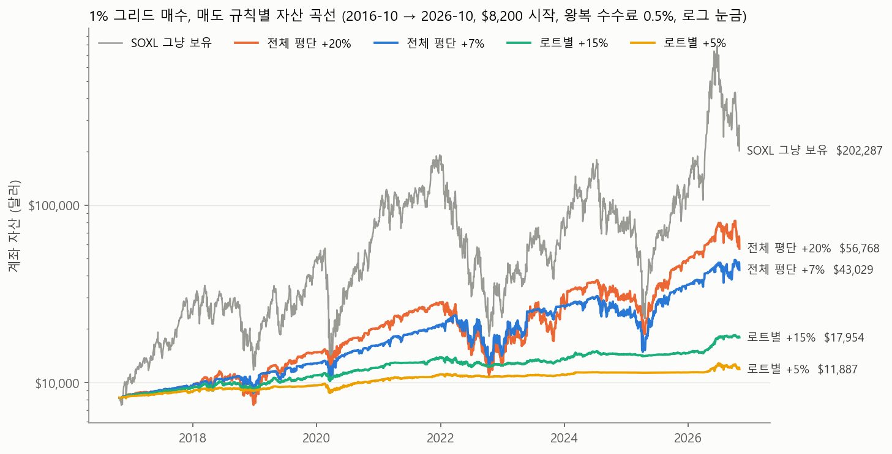
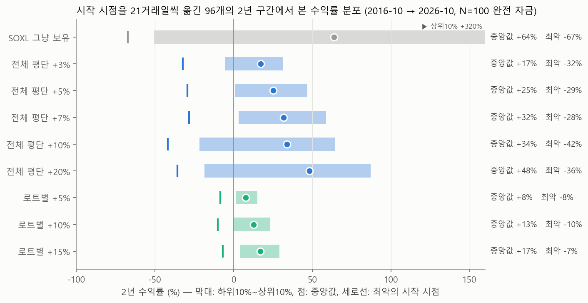
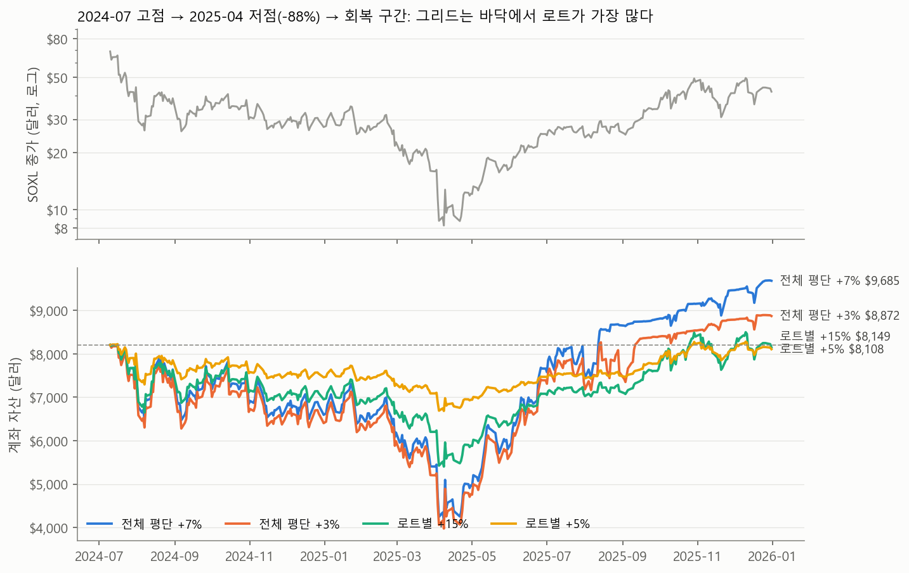

# SOXL 1% 그리드 매수의 매도 규칙 연구 — 2026-11-01

**질문:** "보유가 없으면 현재가에 매수, 그 다음부터는 마지막 매수가보다 1% 낮은 가격에 계속 매수"하는 그리드 전략에서 **언제 파는 것이 가장 수익이 좋은가.**
**방법:** SOXL 일봉 2010-03-11~2026-10-30(yfinance, 분할 반영)에서 2016-10-24~2026-10-30 10년을 주 구간으로 쓰고, 최근 2년은 시간봉, 최근 60일은 5분봉으로 일봉 근사를 검증했습니다. 왕복 수수료 0.5%(편도 0.25%), 시작 자본 $8,200. 매도 규칙 9종류 × 목표 수익률 × 로트 크기를 조합해 약 400개 설정을 돌렸습니다. 재현 스크립트와 TradingView용 Pine 전략은 `scripts/`에 있고, Pine 전략은 TradingView에 직접 올려 Strategy Tester 결과를 이 노트의 수치와 대조했습니다(8절).

---

## 0. 한눈에 보는 결론

1. **매도 규칙 중에서는 "전량 평단가 +5~7%에 매도"가 수익과 낙폭의 균형이 가장 좋습니다.** 10년 +307~425%(연 15~18%), 최대낙폭 -52%, 시작 시점을 바꾼 2년 구간의 90~93%에서 플러스. 목표를 +10~30%로 키우면 10년 합계는 +815%까지 늘지만 그건 폭락장에서 안 팔고 버틴 결과라 최대낙폭 -60%, 1년 구간 하위 10%가 -22~-25%로 나빠집니다. +1~3%는 수수료 0.5%를 빼면 한 사이클 수익이 너무 작아 10년 +54~166%에 그칩니다.
2. **안전을 우선하면 "로트마다 자기 매수가 +10~15%에 매도"입니다.** 수익은 10년 +80~119%(연 6~8%)로 전량 매도의 1/3~1/4이지만, 최대낙폭 -9~-13%, 2022년 -3~-10%(SOXL 자체는 -86%), 2년 구간의 89~97%가 플러스입니다.
3. **쓰지 말아야 할 매도:** 마지막(최저) 매수가 기준 +T% 전량 매도는 10년 -2~-24%로 손실. 트레일링 스톱, 평단 -20~-30% 손절 후 재시작, 20·60일 기간 청산은 모두 단순 목표가 매도보다 나빴습니다.
4. **매도 규칙보다 로트 크기가 손익과 위험을 훨씬 크게 좌우합니다.** 1% 간격 그리드는 로트 주수 × 첫 매수가 × 100 달러가 끝까지 내려갔을 때 드는 돈입니다. $8,200에 SOXL $77이면 **1주/로트가 정확히 "어디까지 떨어져도 현금이 남는" 크기**입니다. 2주/로트로 올리면 -53% 지점에서 현금이 바닥나고, 그 상태로 2022년·2025년 같은 -88% 구간을 맞으면 계좌의 83~87%를 잃습니다(5절).
5. **이 전략의 구조적 한계:** 폭락 바닥에서 로트가 가장 많고(160~210개), 상승장에서는 1~2로트만 들고 있어 평균 노출이 자산의 20~35%입니다. 10년 그냥 보유 +2,355%의 1/3~1/8만 가져가면서 폭락은 절반 가까이 맞습니다. "언제 팔까"로 고칠 수 있는 문제가 아니라 매수 규칙 자체의 성질입니다.
6. **TradingView 실측:** `scripts/soxl_grid.pine`을 TradingView에 직접 올려 돌렸습니다(8절). 컴파일은 한 번에 통과했고, 일봉 10년에서 전체 평단 +7% **+423%**(최대낙폭 64%), 로트별 +15% **+100%**(15%), 시간봉 10년에서는 +335%와 +98%였습니다. 규칙 간 순위는 이 노트와 같습니다. 수치가 2절과 다른 것은 주문 방식(지정가 사다리 선주문)·정수 주수·낙폭 정의 차이 때문이고, 이를 흉내 낸 Python 복제본이 TradingView를 몇 %p 안에서 재현합니다.

---

## 1. 전략 정의와 백테스트 가정

### 1.1 규칙 해석

사용자의 세 규칙에는 정해지지 않은 부분이 셋 있어 다음처럼 고정했습니다.

| 항목 | 해석 | 이유 |
| --- | --- | --- |
| 로트 수량 | 재시작 때마다 `현금 ÷ (N × 가격)` 주. 기본 N=100 | 1% 간격이면 N=100일 때 무한히 떨어져도 매입 총액이 현금과 같음(1.3절). 지금 가격에서 1주/로트와 같음 |
| 전량 매도 뒤 | 규칙 1대로 즉시 재매수. 다음 봉 시가에 1로트 | TradingView에서 시장가 주문이 체결되는 시점과 같음 |
| 부분 매도 뒤 "마지막 매수가" | 팔렸어도 시간상 마지막 체결가를 그대로 씀 | 규칙 2의 글자 그대로. 다음 매수가는 그 가격의 99% |

### 1.2 체결과 비용

- 지정가 매수는 봉의 저가가 지정가 이하면 지정가에, 시가가 이미 지정가 아래면 시가에 체결. 하루에 여러 단계가 체결될 수 있음.
- 봉 안의 순서는 TradingView 기본 가정과 같게: 양봉은 시가→저가→고가→종가, 음봉은 시가→고가→저가→종가. 즉 양봉에서는 매수가 먼저 쌓이고 그 뒤 매도가 걸리고, 음봉은 반대.
- 수수료 편도 0.25%. 목표가는 수수료를 뺀 평단가 기준이라 "+T%"의 실제 순수익은 약 T-0.5%p.
- 배당·환전·세금·슬리피지 제외. 시장가 재진입은 다음 봉 시가.

### 1.3 1% 등비 그리드의 자금 공식

로트 q주, 첫 매수가 P₀, k번째 로트까지 매입액 = 100 × q × P₀ × (1 − 0.99^k). k→∞이면 **100 × q × P₀**.

| 첫 매수가 대비 하락 | 로트 수 | 매입액 (1주/로트, P₀=$77) | 평단가 (P₀ 대비) | 저점에서 평단까지 필요한 반등 |
| --- | --- | --- | --- | --- |
| -30% | 36 | $2,310 | 83% | +18% |
| -50% | 69 | $3,850 | 73% | +45% |
| -70% | 120 | $5,390 | 58% | +94% |
| -88% (2022, 2025) | 211 | $6,780 | 42% | +248% |

$8,200이면 1주/로트는 어디까지 떨어져도 현금이 남습니다. 단, 시작 가격이 $100이면 1주/로트의 한계는 -82%(170로트), $120이면 -68%입니다. 자본이 100 × 가격 × 주수보다 작으면 그 비율만큼 "자금이 끊기는 하락률"이 생깁니다.

### 1.4 비교한 매도 규칙

| 이름 | 규칙 |
| --- | --- |
| 전체 평단 +T% | 가격이 평단가 × (1+T)에 닿으면 전량 매도, 다음 봉 시가에 1로트 재진입 |
| 로트별 +T% | 로트마다 자기 매수가 × (1+T)에 매도. 전부 팔리면 1로트 재진입 |
| 마지막 체결가 +T% | 가장 최근(최저) 매수가 × (1+T)에 전량 매도 |
| 트레일링 | 평단 +T%에 닿은 뒤 고점 대비 -3% 또는 -5%에 전량 매도 |
| 손절 재시작 | 전체 평단 +T% 규칙에 종가가 평단 -20% 또는 -30%면 전량 매도 후 재시작을 추가 |
| 기간 청산 | 전체 평단 +T% 규칙에 사이클 시작 뒤 20 또는 60거래일 경과 시 종가 전량 매도를 추가 |

---

## 2. 10년 결과: 2016-10-24 → 2026-10-30, N=100, $8,200 시작

SOXL 그냥 보유(수수료 반영): **+2,355%, 연 37.6%, 최대낙폭 -90%.**

| 매도 규칙 | 총수익 | 연환산 | 최대낙폭 | 최장 회복 기간 | 매수 횟수 | 매도 횟수 | 최대 로트 | 평균 노출* |
| --- | ---: | ---: | ---: | ---: | ---: | ---: | ---: | ---: |
| 전체 평단 +1% | +54% | 4.4% | -37% | 82일 | 5,599 | 1,390 | 126 | 9% |
| 전체 평단 +2% | +98% | 7.1% | -48% | 291일 | 4,644 | 790 | 163 | 18% |
| 전체 평단 +3% | +166% | 10.3% | -52% | 291일 | 4,329 | 593 | 173 | 20% |
| **전체 평단 +5%** | **+307%** | **15.0%** | **-52%** | 291일 | 3,756 | 390 | 173 | 22% |
| **전체 평단 +7%** | **+425%** | **18.0%** | **-52%** | 291일 | 3,202 | 250 | 173 | 24% |
| 전체 평단 +10% | +298% | 14.8% | -61% | 385일 | 2,336 | 149 | 210 | 30% |
| 전체 평단 +15% | +467% | 18.9% | -60% | 357일 | 2,004 | 94 | 205 | 30% |
| 전체 평단 +20% | +592% | 21.3% | -61% | 385일 | 1,734 | 66 | 210 | 34% |
| 전체 평단 +30% | +815% | 24.7% | -58% | 336일 | 1,446 | 41 | 191 | 35% |
| 로트별 +3% | +45% | 3.8% | -8% | 509일 | 1,468 | 443 | 50 | 4% |
| 로트별 +5% | +45% | 3.8% | -11% | 501일 | 1,223 | 363 | 55 | 4% |
| **로트별 +10%** | **+80%** | **6.0%** | **-9%** | 486일 | 943 | 296 | 53 | 5% |
| **로트별 +15%** | **+119%** | **8.1%** | **-13%** | 489일 | 911 | 276 | 60 | 8% |
| 로트별 +20% | +123% | 8.3% | -16% | 486일 | 769 | 241 | 74 | 9% |
| 마지막 체결가 +3% / +5% / +10% | -24% / -21% / -2% | | -31% / -24% / -19% | | | | | |
| 트레일링 +5% (-3%) / +10% (-3%) | +80% / +153% | 6.0% / 9.7% | -52% / -61% | | | | | |
| +5% 손절 -20% / -30% | +71% / +168% | 5.5% / 10.4% | -28% / -28% | | | | | |
| +10% 손절 -30% | +247% | 13.2% | -27% | | | | | |
| +5% 20일 / 60일 청산 | +59% / +208% | 4.7% / 11.9% | -32% / -40% | | | | | |

\* 평균 노출 = 보유 평가액 ÷ 계좌 자산의 기간 평균. 매도 횟수는 전체 매도 사건 수(로트별은 같은 봉의 여러 로트 매도를 1회로 셈). 전체 설정의 수치는 `data/A_windows.csv`.



**읽는 법**

- 전체 평단 매도의 사이클 승률은 정의상 100%이고, 사이클당 순수익 중앙값은 T-0.5%p(예: +7%이면 +6.5%)입니다. 수익 차이는 "사이클이 얼마나 자주 완성되느냐"와 "완성되지 않는 동안 얼마나 깊이 물리느냐"에서 납니다.
- T가 커질수록 폭락장에서 매도 없이 버티는 기간이 길어져 그냥 보유에 가까워집니다. +10% 이상은 2022년과 2024~25년 폭락 때 **한 번도 팔지 못하고** 160~210로트를 들고 바닥까지 갔습니다(4절). 10년 합계가 큰 이유는 그 뒤 SOXL이 매번 회복했기 때문입니다.
- 로트별 매도는 바닥 쪽 로트부터 조금씩 실현하기 때문에 보유가 50~70로트를 넘지 않습니다. 대신 꼭대기에서 산 로트가 2년 가까이 남아 "최장 회복 기간"이 가장 깁니다. 계좌 전체로는 -9~-16%밖에 안 빠집니다.
- 손절 재시작은 바닥 근처에서 손실을 확정하고 더 작은 포지션으로 다시 시작하는 셈이라 낙폭은 -28%로 줄지만 수익이 절반 이하로 줄었습니다. 트레일링은 SOXL의 급반등이 금방 되돌아와 목표가 매도보다 낮은 가격에 팔립니다.

---

## 3. 시작 시점을 바꿔 본 분포

같은 규칙이라도 꼭대기에서 시작하느냐 바닥에서 시작하느냐에 따라 결과가 크게 달라서, 2016-10부터 시작일을 21거래일씩 옮기며 1년(108개)과 2년(96개) 구간을 모두 돌렸습니다.

**1년 구간 수익률 분포 (N=100)**

| 규칙 | 중앙값 | 하위 10% | 상위 10% | 최악 | 플러스 비율 | 최대낙폭 중앙값 | 최대낙폭 최악 |
| --- | ---: | ---: | ---: | ---: | ---: | ---: | ---: |
| SOXL 그냥 보유 | +52% | -59% | +250% | -87% | 69% | -62% | -90% |
| 전체 평단 +3% | +10% | -14% | +17% | -40% | 75% | -20% | -52% |
| 전체 평단 +5% | +14% | -13% | +28% | -39% | 83% | -20% | -52% |
| 전체 평단 +7% | +17% | -11% | +32% | -39% | 83% | -20% | -52% |
| 전체 평단 +10% | +18% | -22% | +36% | -52% | 80% | -22% | -61% |
| 전체 평단 +20% | +24% | -25% | +46% | -52% | 79% | -21% | -61% |
| 전체 평단 +30% | +25% | -22% | +52% | -50% | 81% | -22% | -60% |
| 로트별 +5% | +6% | -3% | +13% | -16% | 83% | -5% | -22% |
| 로트별 +10% | +9% | -6% | +19% | -15% | 83% | -7% | -32% |
| 로트별 +15% | +12% | -2% | +22% | -20% | 85% | -9% | -34% |
| 로트별 +20% | +13% | -4% | +28% | -18% | 86% | -9% | -42% |

**2년 구간 수익률 분포 (N=100)**

| 규칙 | 중앙값 | 하위 10% | 최악 | 플러스 비율 | 최대낙폭 중앙값 | 최대낙폭 최악 |
| --- | ---: | ---: | ---: | ---: | ---: | ---: |
| SOXL 그냥 보유 | +64% | -51% | -67% | 75% | -80% | -90% |
| 전체 평단 +3% | +17% | -6% | -32% | 84% | -25% | -52% |
| 전체 평단 +5% | +25% | +1% | -29% | 90% | -25% | -52% |
| **전체 평단 +7%** | **+32%** | **+3%** | **-28%** | **93%** | -24% | -52% |
| 전체 평단 +10% | +34% | -22% | -42% | 77% | -25% | -61% |
| 전체 평단 +20% | +48% | -19% | -36% | 80% | -35% | -61% |
| 로트별 +5% | +8% | +1% | -8% | 92% | -11% | -22% |
| 로트별 +10% | +13% | 0% | -10% | 89% | -9% | -32% |
| **로트별 +15%** | **+17%** | **+4%** | **-7%** | **97%** | -12% | -34% |



전체 평단 +5~7%는 2년을 잡으면 열에 아홉은 플러스이고 하위 10%도 0 근처입니다. +10% 이상은 중앙값은 높지만 하위 10%가 -20% 아래로 떨어지고, 이 차이는 전부 폭락 구간에서 팔지 못한 데서 나옵니다. 원자료는 `data/B_rolling1y.csv`, `data/G_rolling2y.csv`.

---

## 4. 연도별 결과와 폭락 구간

2016-10-24부터 한 번도 끊지 않고 돌린 계좌의 연도별 수익률입니다(N=100).

| 연도 | SOXL 보유 | 전체 +3% | 전체 +5% | 전체 +7% | 전체 +10% | 전체 +20% | 로트별 +5% | 로트별 +10% | 로트별 +15% |
| --- | ---: | ---: | ---: | ---: | ---: | ---: | ---: | ---: | ---: |
| 2017 | +142% | +7% | +8% | +10% | +11% | +10% | +6% | +8% | +10% |
| 2018 | -40% | -2% | -1% | +2% | -4% | -11% | +2% | +2% | -1% |
| 2019 | +230% | +25% | +30% | +34% | +48% | +76% | +7% | +10% | +19% |
| 2020 | +70% | +14% | +22% | +27% | +33% | +37% | +7% | +9% | +11% |
| 2021 | +119% | +16% | +23% | +30% | +24% | +39% | +8% | +10% | +14% |
| **2022** | **-86%** | **-34%** | **-31%** | **-30%** | **-53%** | **-53%** | **-3%** | **-3%** | **-10%** |
| 2023 | +225% | +74% | +78% | +83% | +132% | +132% | +3% | +4% | +9% |
| 2024 | -13% | -15% | -12% | -12% | -6% | -4% | +3% | +4% | +5% |
| 2025 | +54% | +39% | +47% | +48% | +45% | +65% | +0% | +0% | +2% |
| 2026 (10월까지) | +83% | +12% | +21% | +21% | +1% | +17% | +4% | +14% | +23% |

2023년의 큰 수익은 2022년 바닥에서 쌓인 163~203로트가 반등에 팔린 것입니다. 즉 전체 평단 매도의 수익은 "폭락 → 회복" 한 쌍에서 대부분 나오며, 회복이 늦거나 오지 않으면 그 해의 -30~-53%만 남습니다.

**꼭대기에서 시작했을 때** (구간별로 $8,200 새로 시작)

| 구간 | SOXL 보유 | 전체 +3% | 전체 +5% | 전체 +7% | 전체 +10% 이상 | 로트별 +5% | 로트별 +10% | 로트별 +15% |
| --- | ---: | ---: | ---: | ---: | ---: | ---: | ---: | ---: |
| 2022-01 → 2022-12 | -87% | -35% | -32% | -31% | -51% (매도 0회) | -7% | -10% | -14% |
| 2024-07-10 → 2025-04-08 | -88% | -52% (매도 1회) | -52% (1회) | -49% (0회) | -49% (0회) | -19% | -28% | -34% |
| 2023-01 → 2024-07 (상승) | +629% | +24% | +31% | +37% | +44~57% | +17% | +24% | +32% |
| 2025-04 → 2026-10 (상승) | +829% | +29% | +55% | +59% | +35~68% | +26% | +46% | +69% |
| 2026-01 → 2026-10 | +62% | +12% | +21% | +20% | -2~+14% | +8% | +20% | +30% |



2024-07 고점에서 시작하면 전체 평단 매도는 9개월 동안 한 번도 목표가에 닿지 못한 채 167~173로트를 들고 -49~-52%까지 갑니다. 로트별 매도도 -19~-34%입니다. 그 뒤 2025년 반등에서 모두 회복하지만, **"언제 파느냐"가 아니라 "SOXL이 회복하느냐"가 결과를 정하는 구간**입니다.

---

## 5. 로트 크기(N)가 매도 규칙보다 중요하다

로트 = 현금 ÷ (N × 가격) 주. N=100이 완전 자금, N=50은 -50%에서 현금이 바닥, N=25는 -25%에서 바닥. 10년 결과(2016-26):

| 규칙 | N=25 | N=33 | N=50 | N=70 | **N=100** | N=150 |
| --- | ---: | ---: | ---: | ---: | ---: | ---: |
| 전체 +7% 총수익 | +1,783% | +1,539% | +877% | +1,004% | **+425%** | +204% |
| 전체 +7% 최대낙폭 | -87% | -86% | -83% | -74% | **-52%** | -34% |
| 전체 +7% 현금 바닥인 기간 | 62% | 49% | 34% | 11% | 0% | 0% |
| 전체 +20% 총수익 | +1,147% | +2,195% | +2,060% | +1,266% | **+592%** | +274% |
| 전체 +20% 최대낙폭 | -89% | -88% | -87% | -82% | **-61%** | -41% |
| 로트별 +10% 총수익 | +826% | +457% | +217% | +130% | **+80%** | +48% |
| 로트별 +10% 최대낙폭 | -38% | -27% | -18% | -13% | **-9%** | -6% |
| 로트별 +15% 총수익 | +1,558% | +836% | +362% | +203% | **+119%** | +69% |
| 로트별 +15% 최대낙폭 | -60% | -42% | -24% | -18% | **-13%** | -9% |

- 로트를 두 배(N=50)로 키우면 전체 평단 매도의 10년 수익은 두 배가 되지만 최대낙폭이 -83~-87%가 됩니다. 2022년과 2025년에 각각 계좌의 5/6을 잃고 회복을 기다린 결과입니다. 계좌가 $8,200인 사람이 견딜 수 있는 경로가 아닙니다.
- 로트별 매도는 바닥에서 로트를 팔아 현금을 돌려받기 때문에 N=50까지는 현금이 바닥나지 않고(0%), 낙폭 -18~-24%에 수익이 2~3배가 됩니다. **로트별 매도를 쓰면 로트를 N=50~70(지금 가격에서 1.5~2주)까지 키우는 선택지가 있습니다.** 전체 평단 매도는 N=100을 넘기지 않는 것이 맞습니다.
- 간격을 1%에서 2~3%로 넓히고 로트를 그만큼 키우면(총 자금 동일) 10년 수익은 +425% → +458~574%(전체 +7%), +119% → +125~132%(로트별 +15%)로 비슷하거나 약간 낫고 매매 횟수는 절반~1/3입니다. 1%라는 간격 자체에 특별한 이점은 없습니다(`data/F_step.csv`).

---

## 6. 일봉 근사의 오차: 시간봉·5분봉 검증

같은 구간을 봉 크기만 바꿔 돌렸습니다(N=100).

| 규칙 | 2년(2024-10-31~2026-10-30) 일봉 | 같은 구간 시간봉 | 60일 일봉 | 60일 시간봉 | 60일 5분봉 |
| --- | ---: | ---: | ---: | ---: | ---: |
| 전체 +3% | +33% | +52% | -6% | -8% | -8% |
| 전체 +5% | +57% | +47% | -9% | -10% | -9% |
| 전체 +7% | +64% | +35% | -8% | -10% | -8% |
| 전체 +10% | +35% | +43% | -7% | -9% | -9% |
| 전체 +20% | +73% | +59% | -7% | -8% | -8% |
| 로트별 +5% | +17% | +23% | -4% | -6% | -5% |
| 로트별 +10% | +37% | +35% | -5% | +4% | +4% |
| 로트별 +15% | +55% | +52% | -6% | -7% | -6% |

최대낙폭과 매수 횟수는 봉 크기와 거의 무관하게 같았습니다. 총수익은 2년 기준 전체 평단 매도에서 ±15~30%p, 로트별에서 ±5%p 흔들립니다. 이 차이는 봉 안에서 매수·매도가 어떤 순서로 걸리느냐에 따른 것으로, **+5%와 +7% 중 어느 쪽이 낫다고 말할 정도의 해상도는 없습니다.** 규칙 간 순위(전체 > 로트별 수익, 로트별 < 전체 낙폭)는 모든 봉 크기에서 같았습니다. 원자료 `data/C_timeframes_2y.csv`, `data/C_timeframes_60d.csv`. TradingView에서 시간봉 10년을 직접 돌린 결과는 8.2절에 있습니다.

---

## 7. 한국 시간대에서의 실행

- **매수:** 마지막 체결가 아래로 지정가를 여러 단계 미리 걸어 두면 자는 동안에도 규칙대로 체결됩니다. 10/30처럼 전일 종가 대비 -31%까지 밀린 날을 덮으려면 40단계(0.99⁴⁰ = -33%)가 필요합니다. 10년 백테스트에서 한 봉에 체결된 단계는 최대 37개였습니다. **40단계**를 권합니다. 체결된 뒤 아래 단계를 다시 채우는 일은 아침에 하면 됩니다.
- **매도:** 전체 평단 매도는 평단가 × (1+T)에 전량 지정가 매도 1건. 로트별 매도는 로트 수만큼 매도 지정가가 필요해 50~70건까지 늘 수 있으니 증권사의 미체결 주문 한도를 확인하세요.
- **재진입:** 전량 매도 뒤 1로트 시장가 매수는 깨어 있을 때 하면 됩니다. 백테스트는 다음 봉 시가(일봉이면 다음 날 22:30 KST 개장가)를 가정했고, 주간거래(09:00~17:00)에서 먼저 사도 결과는 거의 같습니다.
- **수수료:** 전체 평단 +7%는 10년에 매수 3,200회·매도 250회였습니다. 매매 1회 평균 금액이 작아 10년 수수료 총액은 약 $3,000으로 순수익의 9%입니다. 목표가 작을수록 비중이 커져 +3%는 20%, +2%는 31%, +1%는 61%가 수수료로 나갑니다. 로트별 +10~15%는 4~5%입니다.

---

## 8. TradingView 실측

2026-11-01에 TradingView(유료 계정, 로그인 상태)에 접속해 `scripts/soxl_grid.pine`을 SOXL 차트의 Pine Editor에 넣고 Strategy Tester를 직접 돌렸습니다. **컴파일은 수정 없이 한 번에 통과했습니다.** 전략 속성은 초기 자본 $8,200, 수수료 편도 0.25%, 슬리피지 0, 피라미딩 500, 봉 세분화 "기본(봉당 4틱)", 지정가 체결 "요청 가격", 레버리지 1배. 입력값은 간격 1%, 미리 걸어둘 단계 40, 로트 방식 N=100, 기간 2016-10-24부터입니다.

### 8.1 일봉 10년 (2016-10-24~2026-10-30)

| 매도 규칙 | TradingView 총손익 | TV 최대낙폭 | 청산 거래 수 | 2절 Python(순차 주문) | Python TV 복제본(8.3절) |
| --- | ---: | ---: | ---: | ---: | ---: |
| 전체 +3% | +228% | 52% | 4,673 | +166% | +234% |
| 전체 +5% | +355% | 57% | 4,227 | +307% | +350% |
| 전체 +7% | +423% | 64% | 3,516 | +425% | +435% |
| 전체 +10% | +434% | 71% | 2,635 | +298% | +402% |
| 전체 +20% | +818% | 60% | 1,946 | +592% | +846% |
| 로트별 +5% | +39% | 21% | 1,038 | +45% | +40% |
| 로트별 +10% | +59% | 10% | 913 | +80% | +59% |
| 로트별 +15% | +100% | 15% | 875 | +119% | +113% |
| 로트별 +20% | +100% | 32% | 789 | +123% | +103% |

전체 +3%, 로트별 +5%·+20%는 단계 30으로 돌린 값이고, 30과 40의 차이는 전체 +7%에서 0.2%p였습니다. 로트별 매도는 모든 청산이 +T%라 승률 100%로 나옵니다. 캡처 `charts/04_tv_1d_total7.png`, `charts/05_tv_1d_perlot15.png`, 원자료 `data/H_tradingview.csv`.

규칙 간 순위는 2절과 같습니다. 전체 평단 매도가 로트별보다 수익도 낙폭도 크고, +10% 이상은 폭락장을 팔지 못한 채 지나는 대가로 10년 합계가 커집니다. TradingView 10년 합계만 보면 +20%가 가장 크지만, 3·4절에서 본 성질(시작 시점에 따라 1년 구간 하위 10%가 -22~-25%, 2022년과 2024~25년 폭락을 한 번도 팔지 못하고 통과)은 주문 방식과 무관하므로 제안(9절)은 그대로입니다.

### 8.2 시간봉: 2년과 10년

이 계정의 SOXL 시간봉은 2015-01-02부터 있어 10년 시간봉도 돌릴 수 있었습니다(yfinance는 2년까지).

| 구간 | 매도 규칙 | TV 총손익 | TV 최대낙폭 | 거래 수 | Python TV 복제본(시간봉) | 6절 Python(순차 주문) |
| --- | --- | ---: | ---: | ---: | ---: | ---: |
| 2년 2024-10-31~2026-10-30 | 전체 +5% | +40% | 31% | 1,073 | +41% | +47% |
| | 전체 +7% | +64% | 31% | 995 | +64% | +35% |
| | 전체 +10% | +58% | 28% | 809 | +62% | +43% |
| | 로트별 +10% | +21% | 10% | 341 | +21% | +35% |
| | 로트별 +15% | +29% | 22% | 335 | +29% | +52% |
| 10년 2016-10-24~2026-10-31 | 전체 +5% | +299% | 54% | 4,443 | | |
| | 전체 +7% | +335% | 54% | 3,568 | | |
| | 로트별 +10% | +62% | 9% | 1,016 | | |
| | 로트별 +15% | +98% | 12% | 892 | | |

일봉 10년과 비교하면 전체 +7%는 +423% → +335%로 줄고(일봉의 봉당 4틱 가정이 전량 매도를 약 20% 후하게 평가), 로트별 +15%는 +100% → +98%로 같습니다. 캡처 `charts/06_tv_1h_total7.png`.

### 8.3 2절의 Python과 다른 이유: 복제본으로 확인

`scripts/tv_semantics.py`는 Pine 전략의 주문 방식을 그대로 흉내 낸 시뮬레이터입니다. 이것으로 차이의 원인을 셋으로 분리했습니다.

1. **지정가 사다리 선주문.** Pine은 봉 종가에 40단계 지정가를 미리 걸고 다음 봉에 체결시킵니다. 갭 하락으로 시가가 여러 단계 아래면 그 단계가 전부 시가에 한꺼번에 체결되고, 목표가는 직전 종가의 평단 기준으로 봉 안에서 고정되며, 전량 매도 뒤에도 남은 지정가가 같은 봉 안에서 다시 체결됩니다. 2절의 Python은 "체결되면 그 가격의 99%에 다음 주문"이라는 순차 방식이라 갭에서는 시가에 1로트만 사고 그 아래로 1%씩 내려갑니다. 사다리가 폭락에서 더 공격적으로 사기 때문에 전량 매도의 수익과 낙폭이 둘 다 커집니다. 전체 +7%: 순차 +425%(낙폭 -52%) → 사다리 +557%(-63%). 실제 매매에서 주문을 미리 여러 단계 걸어 두면 사다리 쪽, 한 번에 한 주문만 내면 순차 쪽에 가깝습니다.
2. **정수 주수.** TradingView는 주식 수량을 정수로 내림합니다. 자본 $8,200, N=100이면 로트가 1.x주로 계산되는 구간이 길어 1주로 깎이고 그만큼 수익이 줄어듭니다. 전체 +7% +557% → +435%, 로트별 +15% +155% → +113%. 초기 자본을 $8,200,000으로 바꿔 내림 효과를 없애면 TradingView가 +550%(낙폭 66%)와 +151%(16%)를 내 소수 주수 복제본 +557%(66%)·+155%(16%)와 맞습니다. 실제 계좌는 1주 단위로 사므로 $8,200 결과가 현실에 가깝습니다.
3. **낙폭 정의.** TradingView의 Max drawdown은 봉의 저가로 평가한 자산 기준이라 종가 기준보다 3~12%p 깊습니다. 복제본의 저가 기준 낙폭이 TradingView와 1%p 안에서 맞습니다.

복제본($8,200, 정수 주수) 대 TradingView: 전체 +5% +350 대 +355, +7% +435 대 +423, +10% +402 대 +434, +20% +846 대 +818, 로트별 +10% +59 대 +59, +15% +113 대 +100. 시간봉 2년은 다섯 설정 모두 4%p 안입니다. 남은 차이는 시세 데이터와 봉 안 순서의 세부 차이입니다. 봉 안 순서 가정(1.2절)을 "시가가 고가에 더 가까운 봉은 시가→고가→저가→종가"로 바꿔 봐도 결과는 3%p 안에서 같았습니다. 원자료 `data/H_tv_vs_python_1d.csv`, `data/H_tv_vs_python_1h.csv`.

### 8.4 직접 돌리는 법

1. SOXL 차트(1D 또는 1H)에서 Pine Editor를 열고 스크립트를 붙여 넣은 뒤 Ctrl+Enter(차트에 추가). Strategy Tester가 자동으로 열립니다. 10년 일봉에 40단계면 계산은 5~10초입니다. 계정에는 스크립트가 "SOXL 1% 그리드 매도 규칙 연구 (2026-11-01)"로, 전략이 올라간 차트 레이아웃이 "SOXL grid 연구 2026-11-01"(https://www.tradingview.com/chart/9OheHNZS/)로 저장돼 있어 바로 열 수 있습니다.
2. 입력값: 단계 수 40, N=100, 매도 규칙, T, 기간. 속성의 초기 자본은 8,200(정수 주수 효과 포함, 현실에 가까움) 또는 8,200,000(소수 주수 근사).
3. 결과는 Key stats(총손익·최대낙폭·승률)와 거래 목록 탭(체결가·수량)에서 봅니다. 최대낙폭은 봉 저가 기준임을 감안하세요.
4. 주문 9,000건 제한은 10년 시간봉 +5%(청산 4,443건)까지 걸리지 않았습니다. Bar Magnifier는 시험하지 않았습니다. 시간봉 10년 결과(8.2절)가 같은 역할을 합니다.

---

## 9. 제안

**매도 규칙**

- 수익을 우선하면 **전체 평단 +5~7%에 전량 매도** 후 즉시 1로트 재진입. 10년 연 15~18%, 최대낙폭 -52%, 2년 구간 90~93% 플러스. 5와 7 사이의 차이는 노이즈입니다. 체결 확률을 생각하면 +6% 하나로 고정해도 됩니다.
- 낙폭을 우선하면 **로트별 +10~15%**. 연 6~8%, 최대낙폭 -9~-13%, 폭락해 -3~-10%. 이 경우 로트를 N=50~70(1.5~2주)로 키워 연 12~17%, 낙폭 -18~-24%로 맞추는 선택지가 있습니다.
- +10% 이상의 전량 매도, 트레일링, 손절 재시작, 기간 청산, 마지막 체결가 기준 매도는 쓰지 않습니다.
- TradingView 실측(8절)도 같은 순위입니다. 거기서는 지정가를 미리 여러 단계 걸어 두는 방식이라 전량 매도의 수익과 낙폭이 2절보다 크게 나오고, 1주 단위 매수 때문에 로트별 매도의 수익은 작게 나옵니다. 실제 주문 방식에 따라 둘 사이 어딘가가 현실입니다.

**매수 쪽 수정 없이 들어가면 안 되는 것**

- 로트는 **1주**(현금 ≥ 100 × 가격 × 주수)를 지키세요. 가격이 $100을 넘으면 1주/로트도 -82%에서 자금이 끊깁니다. 이 선을 넘긴 설정은 10년 수익이 커 보여도 2022년·2025년에 계좌의 80% 이상이 사라지는 경로를 지납니다.
- 이 전략은 상승장 수익의 대부분을 놓치고 폭락의 절반을 맞는 구조입니다. 2026-10-24 연구의 결론(추세 위 눌림목 5일 보유, 급락 다음 날 반등)과 비교해 어느 쪽이 나은지는 별도로 봐야 하며, 이 노트는 그리드의 매도 규칙만 평가했습니다.

---

## 파일

```text
research/2026-11-01/
├── grid-exit-study.md          ← 이 문서
├── charts/
│   ├── 01_equity_curves.png    ← 10년 자산 곡선, 규칙 4종 + 그냥 보유 (로그)
│   ├── 02_rolling_2y.png       ← 2년 구간 96개의 수익률 분포
│   ├── 03_crash_2024_25.png    ← 2024-07 고점 → 2025-04 저점 → 회복 구간
│   ├── 04_tv_1d_total7.png     ← TradingView 캡처: 일봉 10년, 전체 평단 +7%
│   ├── 05_tv_1d_perlot15.png   ← TradingView 캡처: 일봉 10년, 로트별 +15%
│   └── 06_tv_1h_total7.png     ← TradingView 캡처: 시간봉 10년, 전체 평단 +7%
├── data/
│   ├── soxl_1d_yf.csv / soxl_1h_yf.csv / soxl_5m_yf.csv  ← yfinance 시세
│   ├── A_windows.csv           ← 구간별 × 규칙별 × N(100, 50) 전체 결과
│   ├── B_rolling1y.csv, G_rolling2y.csv ← 시작일을 옮긴 분포
│   ├── C_timeframes_2y.csv, C_timeframes_60d.csv ← 일봉·시간봉·5분봉 비교
│   ├── D_yearly.csv, D_equity_curves.csv ← 연도별 수익률과 자산 곡선
│   ├── E_sizing.csv, F_step.csv ← 로트 크기·간격 민감도
│   ├── H_tradingview.csv       ← TradingView Strategy Tester에서 읽은 결과
│   ├── H_tv_vs_python_1d.csv, H_tv_vs_python_1h.csv ← TradingView 대 Python 복제본 대조
│   └── daily_grid_results.csv  ← 1차 탐색(1주/$100/$200 고정 로트)
└── scripts/
    ├── fetch.py                ← yfinance 시세 내려받기
    ├── grid.py                 ← 그리드 시뮬레이터 (simulate, metrics)
    ├── run2.py, run3.py        ← 표 생성
    ├── charts.py               ← 그림 생성
    ├── tv_semantics.py         ← Pine 주문 방식 복제 시뮬레이터 (TradingView 대조용)
    └── soxl_grid.pine          ← TradingView 전략 (Pine v6, TradingView에서 실행 확인)
```

실행 순서: `fetch.py <data_dir>` → `run2.py <연구 폴더>` → `run3.py <연구 폴더>` → `charts.py <연구 폴더>`. TradingView 대조는 `tv_semantics.py 1d 2016-10-24 2026-10-30 40`, `tv_semantics.py 1h 2024-10-31 2026-10-30 40`. 스크립트 첫 줄은 이 PC의 사용자 패키지 경로를 `python3 -I` 환경에 더하는 코드입니다.
