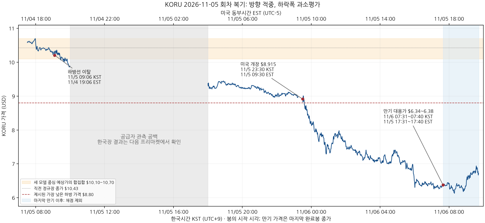

# [KORU] 2026-11-05 24시간 예측 사후 평가 — Codex Astra Max

복기 작성: 2026-11-06 09:57 KST / 2026-11-05 19:57 EST. 실행 ID `20261106-094235`, 작업 ID `koru-review-codex`. **대상 회차는 한국 날짜 2026-11-05, 작성일은 2026-11-06**이다. 세 만기가 모두 지나 **완료 채점**한다. 아래 ‘만기 실제가’는 틱 체결 원장을 확보한 값이 아니라, **만기 전에 완료된 마지막 Yahoo 1분봉 종가**다. 조회 시각과 가격의 시각을 구분했다.

## 1. 한눈에 보는 평가 결론 및 채점표

**세 모델 모두 시간외 기준가 대비 하락 방향은 적중했다. 그러나 약 40%의 실제 하락을 어느 모델도 중심가나 제시한 하방 가격 범위에 담지 못했다.** Claude Fable Max의 만기 대용가는 **$6.38(-39.92%)**, Codex Astra Max는 **$6.34(-40.19%)**, Antigravity Argon High는 **$6.3501(-39.98%)**다. 직전 정규장 종가 **$10.43** 대비로도 **-38.83~-39.21%** 하락했다.

한국 반도체와 외국인 매도의 위험을 지적한 판단은 맞았다. 반면 한국장의 추가 하락과 이어진 미국 반도체·시장 전체의 급락이 함께 발생할 때의 규모를 크게 낮춰 잡았다. **‘시간외 반등분 반납’ 정도의 중심 전망과 ‘정규장 종가 대비 중립 또는 상승’ 판단은 실패했다.** [S0–S5]

### 1.1 네 항목 채점

직전 Codex 복기와 일관되게 **대표 판정 및 메타 JSON의 `verdict`는 ① 시간외 기준가 대비 방향**이다. 이것이 네 항목 전체의 성공을 뜻하지 않는다. ③에서 Codex·Argon의 중립 판단은 보합 전망으로 평가하며, 약 39% 하락을 중립 적중으로 인정하지 않는다. 임의의 중립 허용폭이나 사후 확률을 새로 설정하지 않았다.

| 모델 | 만기 대용가 | 시간외 기준가 대비 | 직전 정규장 종가 $10.43 대비 | ① 방향·대표 판정 | ② 중심 예상가 범위 | ③ 종가 대비 판단 | ④ 시나리오·재검토선 |
| --- | ---: | ---: | ---: | --- | --- | --- | --- |
| Claude Fable Max | **$6.3800** | **-39.92%** | **-38.83%** | **적중** | **미적중**: $10.10~10.70, 하단보다 $3.72 낮음 | **미적중**: 상승 약 55% | **부분 적중**: D의 위험 조건·하방선은 발생, D 가격 $8.80~9.60도 이탈 |
| Codex Astra Max | **$6.3400** | **-40.19%** | **-39.21%** | **적중** | **미적중**: $10.30~10.55, 하단보다 $3.96 낮음 | **미적중**: 중립 | **부분 적중**: `<$10.07` 하락 분류·확인 규칙은 성립, 대표가 $9.20~10.00는 미달 |
| Antigravity Argon High | **$6.3501** | **-39.98%** | **-39.12%** | **적중** | **미적중**: $10.15~10.60, 하단보다 $3.7999 낮음 | **미적중**: 중립~상승 50~52% | **부분 적중**: 투매 조건·$10.23/$10.03 이탈은 발생, $9.10~9.95도 이탈 |

중심 구간의 중간값과 만기 가격 간 절대 오차는 Claude **$4.02**, Codex **$4.085**, Argon **$4.0249**다. 이는 구간 중간값으로 계산한 사후 보조 지표이며 모델이 별도로 제시한 점예측은 아니다. 만기가 서로 다르므로 이 작은 오차 차이를 실력 순위로 해석하지 않는다. **세 모델의 같은 날 방향 적중은 서로 독립적인 3일 표본이 아니다.** 원문 상승 확률 44~45%의 보정 성능도 한 회차로 검증할 수 없다.

남은 시간은 모두 **0분**, 잠정 채점은 없다. 기준가 매수·만기 매도를 가정하고 사용자 왕복 수수료를 단순히 **0.5%p 차감**하면 각각 약 **-40.42%, -40.69%, -40.48%**다. 실제 체결·호가·환전·세금을 반영한 거래 성과가 아니며, 하락 예측 적중을 공매도 수익으로 환산하지 않았다.

### 1.2 원문에서 고정한 예측 조건

세 모델의 직전 종가는 **미국 11/4 정규장 $10.43, 11/5 06:00 KST / 11/4 16:00 EST**로 동일하다. 기준가는 사후 분봉으로 재설정하지 않았다. 원문의 모델 별칭은 이번 실행에서 지정한 명칭으로 통일했다. [S0]

| 모델 | 기준 시각 KST / EST | 기준가 / 직전 종가 대비 | 원문 만기 KST / EST | 방향·상승 확률 | 중심가 / 기준가 대비 | 직전 종가 대비 별도 판단 |
| --- | --- | --- | --- | --- | --- | --- |
| Claude Fable Max | 11/5 07:38 / 11/4 17:38 | $10.62 / +1.82% | **11/6 07:40 / 11/5 17:40** | 하락 소폭 우세·약 45% | $10.10~10.70 / -4.90~+0.75% | 상승 소폭 우세·약 55% |
| Codex Astra Max | 11/5 07:33:38 / 11/4 17:33:38 | $10.60 / +1.63% | 11/6 07:33:38 / 11/5 17:33:38 | 중립에 가까운 약한 하락 우세·약 45% | $10.30~10.55 / -2.83~-0.47% | 중립, 중심 범위는 $10.43 대비 -1.25~+1.15% |
| Antigravity Argon High | 11/5 07:31 / 11/4 17:31 | $10.58 / +1.44% | 11/6 07:31 / 11/5 17:31 | 하락 소폭 우세·약 44% | $10.15~10.60 / -4.06~+0.19% | 중립~보합 경합·상승 약 50~52% |

**Claude의 원문은 정확히 24시간보다 2분 긴 만기**를 명시했다. 원문 만기 07:40을 주 평가로 삼고, 정확히 24시간 뒤인 **11/6 07:38 KST / 11/5 17:38 EST**도 별도로 계산했다. 그때의 직전 완료봉 가격은 **$6.39**, 기준가 대비 **-39.83%**로 모든 판정이 같다. Claude 본문에 뒤늦게 추가된 **11/5 08:04·09:10 KST / 11/4 18:04·19:10 EST** 관측과 상승 확률 40%로의 업데이트는 07:38 원예측의 입력이나 확률로 소급하지 않았다.

### 1.3 만기 가격을 정한 방법

`1분봉 시작시각 + 1분 ≤ 만기`인 유효 가격 중 마지막 `Close`를 선택한다. 해당 분이 없으면 그보다 앞선 마지막 유효 완료봉으로 돌아가며, 미래 체결을 포함하는 만기분 종가나 복기 당시의 최신가는 쓰지 않는다. 이번 세 만기 바로 앞 완료봉은 모두 존재한다.

| 모델 | 선택한 봉 시작 KST / EST | 봉 완료 KST / EST | 만기와 봉 완료의 차이 | 가격 |
| --- | --- | --- | ---: | ---: |
| Claude | 11/6 07:39 / 11/5 17:39 | 11/6 07:40 / 11/5 17:40 | 0초 | $6.3800 |
| Codex | 11/6 07:32 / 11/5 17:32 | 11/6 07:33 / 11/5 17:33 | 38초 | $6.3400 |
| Argon | 11/6 07:30 / 11/5 17:30 | 11/6 07:31 / 11/5 17:31 | 0초 | $6.3501 |

봉 안의 마지막 체결 초와 거래소는 확인되지 않는다. 표의 0초·38초는 **봉 완료 시각과의 간격**이지 마지막 체결의 정확한 경과시간이 아니다. Yahoo 시간외 `Volume=0`은 거래량 미제공으로 취급하고 무체결로 단정하지 않았다. 개별 체결 원장·NBBO가 없어 정확한 초 단위 만기가와 실행 가능한 매도가에는 한계가 있다.

민감도 확인으로 **만기 시각 라벨의 봉 전체 종가**를 쓰면 Claude **$6.37**, Codex **$6.3399**, Argon **$6.34**다. 미래 수십 초를 포함할 수 있어 주 채점에는 제외했으며, 네 항목의 판정은 바뀌지 않는다. 전 회차 복기는 분 라벨 봉 종가를 주로 사용했지만, 이번에는 Codex 원문이 명시한 ‘만기 뒤 체결 제외’와 초 단위 만기에 맞춰 완료봉 규칙을 세 모델 모두에 동일 적용했다.

1분봉·일봉 조회는 **11/6 09:44:24~09:44:28 KST / 11/5 19:44:24~19:44:28 EST**다. 직접 Yahoo chart API로 **09:45:48 KST / 19:45:48 EST**에 다시 받은 원시 JSON에서도 세 채점 봉의 가격이 일치한다. 두 조회는 같은 공급자이므로 독립된 거래소 체결 검증으로 보지는 않는다. [S1]

## 2. 실제 주가 경로 복기(국면 분해)

그림은 관측 공백을 연결하지 않았다. 중심 예상가의 합집합은 $10.10~10.70이고, 가장 낮게 제시된 하방 가격은 Claude의 $8.80이다. 이 가격도 미국 개장 직후 무너졌다.

### 2.1 시간대별 실제 경로

표의 분봉 가격은 별도 표시가 없으면 해당 구간의 관측값이다. 경제지표·뉴스의 발생 시각과 사후 수집 시각을 구분했다. 가격과 뉴스의 동행은 확인할 수 있지만, 특정 뉴스 하나의 인과적 기여율은 추정하지 않았다. [S1, S3–S11]

| 국면 | KST / EST | 확인한 경로 | 동인과 예측의 성패 |
| --- | --- | --- | --- |
| ① 시간외 반등 후 한국 개장 충격 | 11/5 07:31~10:00 / 11/4 17:31~20:00 | KORU 고가 **$10.7199(07:58 / 17:58)** → **$10.23 아래 종가(09:06 / 19:06)** → 마지막 09:59 / 19:59 봉 **$9.89** | 원문이 우려한 한국 반도체 약세가 나타남. NXT 개장 시간대의 가격 하락과도 일치하지만 전일 NXT 체결 원장은 이번에 확보하지 못함 |
| ② 한국장 하락 확대 | 11/5 10:00~15:30 / 11/4 20:00~11/5 01:30 | 코스피 시가 **5,580.09** → 저가 **5,336.88** → 종가 **5,383.80(-5.28%)**. 삼성전자 **201,500원(-7.57%)**, SK하이닉스 **1,264,000원(-9.46%)** | 외국인 대량 현물 매도와 반도체·AI 인프라 약세. 전날처럼 V자로 회복하거나 비반도체가 지수를 충분히 방어하지 못함 |
| ③ 미국 프리마켓 재평가 | 11/5 18:00~23:30 / 11/5 04:00~09:30 | 첫 봉 **시가 $9.48·종가 $9.37** → 23:14 / 09:14 마지막 관측 봉 **$8.98** | 한국 종가가 확정된 뒤 이미 기준가를 크게 밑돎. 세 모델의 중심가를 유지할 근거 약화. 23:15~23:29 / 09:15~09:29 데이터 공백 |
| ④ 미국 개장 첫 1시간 | 11/5 23:30~11/6 00:30 / 11/5 09:30~10:30 | KORU 시가 **$8.915**, 고가 **$9.0699(23:33 / 09:33)** → 00:29 / 10:29 봉 종가 **$7.815** | 미국 반도체 반등 실패. SOXX는 첫 몇 분 반등 후 시가 아래로 밀려 Claude의 실패형 조건과 일치. 한국장 충격에 추가 매도가 겹침 |
| ⑤ 미국장 후반 위험회피 | 11/6 00:30~06:00 / 11/5 10:30~16:00 | 중간 반등 고가 **$8.03(01:35 / 11:35)** 이후 다시 하락. 마지막 05:59 / 15:59 봉 **$6.51**, Yahoo 일봉 종가 **$6.53** | MU·AMD 급락과 미국 시장 전체 하락, VIX 상승. ‘미국 반도체 되돌림’에 의존한 완충 가정이 실패 |
| ⑥ 만기 시간외 | 11/6 06:00~07:40 / 11/5 16:00~17:40 | 시간외 저가 **$6.24(07:09 / 17:09)**, 세 만기 대용가 **$6.34~6.38** | 미국장 하락 뒤에도 중심 예상가로 회복하지 못함. 추가 특정 공시가 원인이라고 확정할 자료는 없음 |

**한국장 폐장 뒤에도 하락이 끝나지 않았다는 점이 핵심이다.** 한국장은 이미 코스피 -5.28%로 마감했고 미국 개장가는 $8.915였지만, 그 이후에도 KORU는 $6대까지 밀렸다. 하루 수익률을 ‘한국장 전망 × 3’으로만 계산하면 이후 미국 업종·환율·다음 한국장 기대의 재평가를 놓친다. KORU의 공식 목표는 MSCI Korea 25/50 지수의 **일일** 3배이고 EWY는 보조 관측 대상이다. 임의의 시간외 24시간 수익률이 EWY 시장가격 수익률의 정확히 3배라는 등식은 적용하지 않았다. [S12]

### 2.2 한국장·수급·환율·야간선물

한국장 마감값은 **11/6 09:45:48 KST / 11/5 19:45:48 EST**에 받은 네이버 코스피 일별 API, 한국 종목 Yahoo 일봉, 마감 기사로 확인했다. Yahoo 코스피 일봉에는 11/5 행이 빠져 있고 한국 1분봉은 **11/5 14:59 KST / 00:59 EST**에서 끝나므로, 이 마지막 분봉을 종가로 쓰지 않았다.

아시아경제의 **11/5 16:38 KST / 02:38 EST 수정본**은 외국인 코스피 순매도를 **3조 4,242억 원**, 유안타·인포스탁의 **17:12 KST / 03:12 EST 작성 시황**은 **3조 4,335억 원**으로 집계한다. 서울파이낸스에는 **3조 8,316억 원**으로 더 큰 값이 있어 정확한 수급 확정치를 단일 숫자로 단정하지 않는다. 본문 판단은 **외국인 대량 현물 순매도 지속**이라는 공통 사실에 한정한다. 유안타는 외국인 선물 **6,830계약 순매수**도 함께 기록하므로 ‘외국인 현·선물 동반 투매’로 확대 해석하지 않는다. [S4, S5]

한국장 일부 자동차·은행·바이오는 상승했지만 삼성전자·SK하이닉스 하락을 상쇄하지 못했다. 특히 원문이 완충 요인으로 기대한 2차전지는 마감 보도에서 약세였으므로, ‘비반도체 강세가 있다’와 ‘MSCI Korea 바스켓 전체가 방어된다’를 구분해야 했다. 코스피 **5,570·5,620·5,700**의 모든 원문 회복 기준은 마감 기준 충족하지 못했다.

환율은 한국장 **11/5 15:30 KST / 01:30 EST**에 **1,342.1원**으로 보도됐지만, 미국장 **11/6 00:20 KST / 11/5 10:20 EST** 분봉 종가에서 **1,350.08원**으로 Codex 관찰선 1,350원을 처음 넘었다. **05:59 / 15:59**에는 **1,356.26원**, **07:37 / 17:37**에는 **1,357.17원**이었다. 한국 낮의 안정된 원화를 미국장까지 고정한 가정은 맞지 않았다. 환율 상승은 달러로 환산한 한국 자산 가치에 부담이지만, 여기서 그 기여도를 가격 하락과 따로 계량 분해하지 않았다. [S1, S5]

PreKOSPI는 **11/5 18:00~11/6 06:00 KST / 11/5 04:00~16:00 EST** 야간선물 세션의 마지막 값을 **771.40**, **야간 시가 대비 -8.39%**로 표시했다. **09:45:48 KST / 19:45:48 EST**에 저장한 화면이며, 이 비율을 주간 종가 대비 수익률로 바꾸어 쓰지 않았다. 반면 mkospi 화면은 **877.32·05:20 KST**와 이전 한국 종가 889.25를 유지하고 있어 날짜가 뒤처진 자료로 보고 이번 야간장 근거에서 제외했다. 거래소 원장과 정확한 마지막 체결 시각은 확보하지 못했으므로 야간선물은 방향 보조 자료다. [S6]

네이버의 이번 `overMarketPriceInfo`는 **11/6 09:44 KST / 11/5 19:44 EST의 NXT 정규 세션** 값이다. 전일 NXT 프리·애프터마켓 가격으로 소급하지 않았다. 원문 Claude의 11/5 NXT 프리마켓 관측은 당시 노트의 관측으로만 인용하며, 이번에 독립 검증한 체결 자료와 구분한다. 네이버 종목별 일별 API도 정규·시간외 경계가 섞인 값이 있어 한국 정규장 수익률은 Yahoo와 마감 보도가 일치하는 값을 채택했다.

### 2.3 미국장: 실적 우려에서 시장 전체 위험회피로 확대

예측 당시에 이미 알려졌던 QCOM 실적 후 하락과 MU 약세는 적절한 경고 신호였다. 다만 실제 미국장에서는 반도체 반등이 나오지 않았고, 전날의 ‘미국 지수 상승·반도체 하락’ 분리도 유지되지 않았다. Yahoo 장중·마감 보도는 데이터센터 규제 우려와 AI 종목 매도를 주요 배경으로 설명한다. **‘규제 우려가 가격을 압박했다’는 보도와 ‘실제 주문이 취소됐다’는 사실은 다르며, 후자는 이번 자료로 확인하지 않았다.** [S7]

| 미국 11/5 지표 | Yahoo 일봉 11/4 → 11/5 | 일간 변화 | 교차 확인·주의 |
| --- | --- | ---: | --- |
| KORU | $10.43 → $6.53 | **-37.39%** | Stock Analysis $6.51(-37.58%), 마지막 정규장 분봉도 $6.51 |
| EWY | $152.12 → $131.65 | **-13.46%** | Stock Analysis $133.01(-12.56%), 마지막 정규장 분봉 $132.92 |
| SOXX | $450.41 ÷ 3 → $131.90 | **-12.15%** | Stock Analysis $130.94(-12.79%), 마지막 정규장 분봉 $130.935 |
| MU | $795.23 → $656.39 | **-17.46%** | Yahoo 일봉 기준 |
| QCOM | $173.19 → $156.75 | **-9.49%** | Yahoo 일봉 기준; 실적 발표는 전날 정보 |
| AMD | $488.78 → $404.40 | **-17.26%** | Yahoo 일봉 기준 |
| S&P 500 | 7,688.62 → 7,353.73 | **-4.36%** | Yahoo 마감 보도와 방향·규모 일치 |
| Nasdaq Composite | 25,736.51 → 24,315.00 | **-5.52%** | Yahoo 마감 보도와 일치 |
| VIX | 16.61 → 28.18 | **+69.66%** | 전날 낮아진 변동성을 그대로 연장할 수 없었음 |

Yahoo 수집 시각은 **11/6 09:44:24~28 KST / 11/5 19:44:24~28 EST**, Stock Analysis 교차 확인은 **11/6 09:48~09:49 KST / 11/5 19:48~19:49 EST**다. **공급자 일봉·마지막 분봉의 차이가 남아 있어 단일 공식 최종종가로 확정하지 않았다.** Nasdaq `info.secondaryData`는 KORU $6.70을 정규장 종가로 표시했지만 다른 종가 자료와 어긋나 채점에서 제외했다. Nasdaq historical과 Direxion 가격표는 아직 11/4까지여서 11/5 최종종가를 확정하는 교차 자료로 쓸 수 없었다. 이 차이는 **$10.43 기준 및 $6.34~6.38 만기 분봉**을 사용하는 주 채점에 영향을 주지 않는다. [S1, S2, S8]

**SOXX 분할 보정:** SEC의 10/23 공시는 **11/5 미국 거래 개시부터 3대1 분할** 적용을 명시한다. 이번 Yahoo 일봉은 이전 종가 $450.41을 그대로, 새 종가를 $131.90으로 줬지만, 과거 1분봉은 이미 분할을 반영했다. 일봉 비교는 전일 종가를 3으로 나누고 분봉을 추가로 3으로 나누지 않았다. 보정하지 않은 기계적 폭락률은 사용하지 않았다. [S9]

**11/5 22:30 KST / 08:30 EST** 생산성 발표는 비농업 생산성 **+3.6% 연율**, 단위노동비용 **-0.7% 연율**이었다. BLS 자료의 검색 본문과 Schwab의 당시 해설을 대조했으며, 공시 원문 직접 다운로드는 실패했다. 이 수치를 ‘물가 악화 때문에 반도체가 급락’한 근거로 쓰기는 어렵다. 신규 실업수당 발표 원자료는 확보하지 못해 수치·기여도 판정에서 제외했다. 다음 미국 고용보고서는 **11/6 22:30 KST / 08:30 EST**로 모든 예측 만기 뒤이므로 이번 하락의 관측된 발표 원인으로 사용하지 않는다. [S10, S11]

### 2.4 만기 뒤 경로는 별도 관찰

만기 이후 **11/6 08:19 KST / 11/5 18:19 EST**에는 KORU 저가 **$6.07**, **09:39 / 19:39**에는 고가 **$6.95**, 마지막 완료 **09:43 / 19:43** 봉 종가는 **$6.72**였다. 이 반등으로 이미 끝난 예측 점수를 바꾸지 않는다. 당시 한국장·NXT의 추가 급락과 ETF 시간외 반등이 동시 관측될 수 있다는 점도, 서로 다른 시장·기준시각을 고정해야 하는 이유다. [S1, S3]

## 3. 모델별 상세 평가(잘한 점·놓친 점)

### 3.1 Claude Fable Max

**잘한 점:** 시간외 프리미엄과 한국장 하방 위험을 구분했고, 코스피 **5,570 아래+외국인 순매도**, KORU **$10.225 이탈**, 미국 반도체 개장 반등 실패를 구체적인 재검토 조건으로 제시했다. 실제 코스피 종가 5,383.80은 해당 하방선 아래였으며, 미국장에서도 반등 실패가 나타났다.

**놓친 점:** ‘종가 $10.43 기준 상승 약 55%’와 중심 $10.10~10.70는 모두 빗나갔다. 원문의 A **30%·$10.80~11.50**, B **28%·$10.40~10.80**, C **29%·$9.60~10.40**, D **13%·$8.80~9.60** 중 위험 조건은 D에 해당하지만 만기가는 D 하단보다 **$2.42** 낮다. D가 발생했다고만 적으면 가격 위험의 실패를 가리게 된다. 코스피 종가를 중심으로 한 평균적 관계는 미국장의 별도 충격을 충분히 포괄하지 못했다.

기준시각 뒤 관측을 추가한 점과 24시간 2분의 만기도 재현성을 낮춘다. 다음에는 원예측과 업데이트의 기준 시각·가격·확률을 별도 행으로 고정해야 한다. 이번 점수는 처음 제시한 $10.62·상승 45%를 유지했다.

### 3.2 Codex Astra Max — 본인 평가

**잘한 점:** 기준가 $10.60과 종가 $10.43을 분리하고, 반등 통계를 곧바로 상승 확률로 간주하지 않았으며, KORU와 EWY의 동시 확인 및 정규장 15분봉 두 개라는 실행 가능한 관측 절차를 적었다. 기준가 대비 하락 방향은 맞았다.

**놓친 점:** 중심가 $10.30~10.55는 실제 만기가보다 약 $4 높았다. 원문 시나리오는 등락 **40%·분류 $10.07~11.13·대표 $10.20~10.80**, 하락 재개 **35%·분류 <$10.07·대표 $9.20~10.00**, 반등 지속 **25%·분류 >$11.13·대표 $11.20~11.80**였다. **하락 분류에 하한이 없다는 이유만으로 $6.34를 가격 예측 적중이라고 주장할 수 없다.** 분류는 맞고 대표 범위는 틀렸다.

시간외에서 KORU와 EWY가 함께 하방선을 이탈한 **11/5 09:06 KST / 11/4 19:06 EST 봉**부터 재검토 근거가 있었다. 다만 실제 양방향 호가를 확보하지 못해 원문의 시간외 확인 절차가 완전히 충족됐다고 소급 주장하지 않는다. 정규장의 두 완료 15분봉은 아래처럼 확인된다.

| 봉 완료 KST / EST | KORU 종가, 하방선 $10.23 | EWY 종가, 하방선 $151.36 | 판정 |
| --- | ---: | ---: | --- |
| 11/5 23:45 / 11/5 09:45 | $8.5801 | $143.36 | 첫 확인 |
| **11/6 00:00 / 11/5 10:00** | **$8.2597** | **$141.71** | **두 봉 연속 조건 충족** |

그때 KORU는 이미 제시한 하락 대표 범위 하단 $9.20 아래였다. **신호 확인 이후의 새 중심가·범위·대응을 규정하지 않은 것이 결함**이다. 원문은 자동 갱신되지 않는다고 명시했으므로, 실제로 전망을 갱신하거나 주문을 실행했다고 기록하지 않았다.

본인 저장소 예측의 ‘사후 결과 복기’와 프론트매터 `status`는 이번 결과로 갱신했다. **볼트 원본은 MCP 연결 실패로 읽거나 갱신하지 못했다.** 볼트 본문 후보와 복기 절을 데이터 폴더에 보관했지만, `version`을 받지 못했으므로 `ifMatch` 쓰기나 읽기 재검증을 수행했다고 주장하지 않는다. 메타의 `own_note_updated`는 저장소·볼트 모두 완료해야 참이라는 보수적 해석으로 **false**다.

### 3.3 Antigravity Argon High

**잘한 점:** MU·QCOM 약세가 한국 반도체와 KORU에 전이될 위험을 지적했고, **$10.23·$10.03 이탈 시 하락 가속**을 제시했다. KORU 분봉은 첫 종가 기준 각각 **11/5 09:06·09:39 KST / 11/4 19:06·19:39 EST**에 이탈했다. 해당 봉 완료 확인은 각각 1분 뒤다.

**놓친 점:** 강한 반등 **16%·$11.10~11.90**, 저가 방어 **28%·$10.58~11.10**, 중심 되밀림 **36%·$9.95~10.58**, 투매 연장 **20%·$9.10~9.95**의 어느 가격대에도 만기가가 들어가지 않았다. 최하단보다 **$2.7499** 낮았다. 비반도체·원화 안정·과매도 반등이 충격을 줄여줄 것이라는 가정이 지나치게 강했다.

Argon의 EWY ‘할인 없음’과 Claude의 ‘약 1% 할인’은 공정가치 산식과 정렬 기준이 다르다. 하락 결과만으로 어느 iNAV 계산이 옳았는지 결정할 수 없다. 이번에는 해당 산식을 재구축하지 않았으므로 ‘미할인 통계가 검증됐다’고 평가하지 않는다.

### 3.4 공통 재검토선의 작동과 한계

| 원문 조건 | 실제 경로 확인 KST / EST | 평가 |
| --- | --- | --- |
| $10.225~10.23 하향 이탈 | 11/5 **09:03 / 11/4 19:03** 첫 저가 $10.21; **09:06 / 19:06** 첫 종가 $10.21 | 세 모델 하방 경고에 부합. 순간 터치와 봉 완료를 구분 |
| Argon $10.03, Codex $10 재시험 | 11/5 **09:39 / 11/4 19:39** 종가 $10.01; **09:52 / 19:52** $9.96 | 지지 실패가 확인됨 |
| Codex $9.20·Argon $9.10 하방 대표 범위 이탈 | 11/5 **21:00 / 07:00** 종가 $9.19, **21:25 / 07:25** $9.08 | 미국 개장 전 이미 가격 범위 재설정 필요 |
| Claude 최하단 $8.80 | 11/5 **23:31 / 09:31** 저가 $8.70, **23:36 / 09:36** 종가 $8.75 | 미국 개장 후 모든 제시 하방 가격 범위 이탈 |
| 상방 $10.85~11.03 및 Codex EWY $155.06 | 공통 관측 구간 KORU 최고 $10.7199 | KORU 상방 조건부터 불성립. 상방 전환 판정 없음 |

시간외 첫 관측 이탈은 매도 가능 가격이나 확정된 손절 체결을 뜻하지 않는다. **보유 포지션·주문 이력이 없으므로 재검토선의 실제 실행 성과는 평가 대상이 아니다.** 원문 백테스트는 이번 복기에서 새로 계산하지 않았으며 N·상승률·평균·중앙값을 재검증한 새 통계로 인용하지 않았다. 이번 사례만으로 기존 반등 통계 전체가 틀렸다고 결론짓지도 않는다.

## 4. 다음 예측에 쓸 교훈

아래는 이번 사례에서 도출한 **운영 규칙 제안**이며 아직 백테스트로 검증된 매매 전략은 아니다.

1. **한국장 마감과 미국장 개장 뒤에 각각 새 예측을 저장한다.** 최초 예측은 고정하고, 한국 종가·외국인 현물 수급·두 반도체주의 회복 여부를 반영한 업데이트와 미국장 첫 두 15분봉 뒤 업데이트를 별도 기준가로 남긴다. 한국장에서 하방 시나리오가 확인된 뒤 미국 반도체도 저점을 낮추면 기존 ‘소폭 하락’ 중심 범위를 폐기하고 다시 계산한다.
2. **하방 시나리오를 분류 기준과 가격 범위로 따로 채점한다.** `<$10.07`처럼 하한 없는 분류가 맞아도 $9.20~10.00 대표 범위가 맞았다고 쓰지 않는다. 범위 하단을 완료봉으로 이탈하면 ‘범위 무효’와 새 확인 시각을 기록한다. 다음 전망은 중심·상하위 분위·범위 밖 위험을 분리하고, 분위수를 제시할 때는 N·상승 비율·평균·중앙값·기간을 함께 저장한다.
3. **역추세 반등 기대에는 관측 가능한 회복 조건을 붙인다.** 낮은 RSI·저가 마감만으로 종가 대비 상승이나 중립을 주지 않는다. 한국 반도체 두 종목의 기준 종가 회복, 외국인 현물 매도 완화, EWY와 분할 보정 SOXX의 동반 회복 중 무엇을 필수로 볼지 미리 적는다. 확인 전에는 비반도체 상승이나 전날 낮은 VIX를 충격 상쇄로 확정하지 않는다.
4. **시세는 시각·시장·분할·공급자를 함께 고정한다.** 만기 전에 완료된 마지막 1분봉, 봉 시각과 지연, 원래 기준가, 직전 종가를 저장한다. NXT 현재값을 전일 정규장 값으로 쓰지 않고, 일봉과 분봉의 종가가 다르면 병기한다. SOXX처럼 일봉·분봉의 분할 반영이 다를 때 조정 배수를 확인한 뒤 수익률을 계산한다.
5. **방향 적중과 투자 성과를 별도 관리한다.** 모든 복기에 방향·중심 범위·직전 종가 대비 판단·재검토 조건을 나눠 기록하고, 실제 주문이 없으면 실현수익을 만들지 않는다. 다음 전망의 보합 판단은 왕복 비용 0.5%와 불확실성을 함께 제시하며, 한 회차의 적중을 근거로 확률을 올리거나 하락 예측을 숏 수익으로 환산하지 않는다.

## 5. 참조 문서 및 데이터 출처

### 5.1 원문·수집 파일·재현

- [Claude 직전 예측](../2026-11-05/koru-forecast-24h-claude.md), [Codex 직전 예측](../2026-11-05/koru-forecast-24h-codex.md), [Argon 직전 예측](../2026-11-05/koru-forecast-24h-argon.md). 원문 조건·시나리오와 수정 전 SHA-256은 `research/2026-11-06/koru-data/codex/forecast_inputs.json`에 고정했다. [S0]
- 형식 참고: [직전 Codex 복기](../2026-11-05/koru-review-codex.md). **오늘 다른 모델의 노트는 열거나 수정하지 않았다.**
- [계산 결과](koru-data/codex/analysis.json), [채점표](koru-data/codex/scores.csv), [시각별 가격과 지연](koru-data/codex/checkpoints.csv), [수집 시각](koru-data/codex/collection_manifest.json), [교차조회 기록](koru-data/codex/crosscheck_manifest.json), [검증 결과](koru-data/codex/validation.json).
- `KORU_1m.csv` 및 직접 조회 원본 `yahoo_KORU_1m_raw.json`, 미국·한국·환율 1분봉과 일봉, 네이버 JSON, 기사 HTML·텍스트를 같은 데이터 폴더에 보관했다. 데이터 공백은 **11/5 10:00~18:00 KST / 11/4 20:00~11/5 04:00 EST**, **11/5 23:15~23:29 KST / 09:15~09:29 EST**다. 이 구간의 가격과 돌파 시각은 보간하지 않았다.
- 재계산은 저장소 루트에서 `PYTHONDONTWRITEBYTECODE=1 python3 research/2026-11-06/koru-data/codex/analyze.py`, 그림은 같은 폴더의 `plot_path.py`로 재현한다. `collect.py`·`crosscheck.py`를 다시 실행하면 수집 스냅샷이 바뀌므로 원본 복기 재현에는 실행하지 않는다.

### 5.2 출처 URL과 확인 범위

| ID | 출처 | 확인한 내용·접근 한계 |
| --- | --- | --- |
| S0 | 위 세 직전 예측 원문 및 직전 복기 | 예측 입력·채점 관행. 오늘 다른 모델 산출물은 참조하지 않음 |
| S1 | [Yahoo KORU 1분봉](https://query1.finance.yahoo.com/v8/finance/chart/KORU?range=5d&interval=1m&includePrePost=true), [EWY](https://query1.finance.yahoo.com/v8/finance/chart/EWY?range=5d&interval=1m&includePrePost=true), [SOXX](https://query1.finance.yahoo.com/v8/finance/chart/SOXX?range=5d&interval=1m&includePrePost=true), [MU](https://query1.finance.yahoo.com/v8/finance/chart/MU?range=5d&interval=1m&includePrePost=true), [USD/KRW](https://query1.finance.yahoo.com/v8/finance/chart/KRW%3DX?range=5d&interval=1m&includePrePost=true) | 09:44:24~28 KST / 19:44:24~28 EST 수집, KORU 직접 원본 09:45:48 / 19:45:48 대조. 다른 종목 URL은 manifest에 보존 |
| S2 | [Nasdaq KORU historical](https://api.nasdaq.com/api/quote/KORU/historical?assetclass=etf&fromdate=2026-11-02&todate=2026-11-05&limit=100), [quote info](https://api.nasdaq.com/api/quote/KORU/info?assetclass=etf) | 전자는 11/4까지만 반환. 후자의 종가 $6.70은 불일치로 제외 |
| S3 | [네이버 코스피 일별](https://m.stock.naver.com/api/index/KOSPI/price?pageSize=10), [삼성전자 현재](https://m.stock.naver.com/api/stock/005930/basic), [SK하이닉스 현재](https://m.stock.naver.com/api/stock/000660/basic) | 코스피 11/5 종가. NXT 현재 필드는 만기 뒤 관측; 전일 체결로 소급하지 않음 |
| S4 | [아시아경제 11/5 마감](https://www.asiae.co.kr/article/2026110515540205579), [서울파이낸스 마감](https://www.seoulfn.com/news/articleView.html?idxno=642052) | 한국 종가·반도체·수급·사이드카. 09:45:48 / 19:45:48 HTTP 원문 확보. 수급 숫자 불일치 공개 |
| S5 | [유안타·인포스탁 11/5 한국장 시황](https://04.myasset.com/myasset/research/rs_global/RS_0401000_M.cmd?glblGubun=KS) | 11/5 17:12 KST / 03:12 EST 작성 내용. 현물·선물 수급, 서울 환율, 비반도체 반응. 상단 날짜와 본문 시황 날짜 구분 |
| S6 | [PreKOSPI](https://www.prekospi.com/), [mkospi](https://mkospi.com/) | PreKOSPI 해당 야간 세션 771.40·시가 대비 -8.39%. mkospi 이전 세션 값은 제외 |
| S7 | [Yahoo 11/5 미국장 라이브·마감](https://finance.yahoo.com/markets/live/stock-market-today-thursday-november-5-dow-sp-500-nasdaq-plunge-chip-stocks-melt-down-193726491.html) | AI·반도체 매도와 시장 전체 위험회피. 최종 갱신 11/6 09:34 KST / 11/5 19:34 EST; 개별 장중 항목의 시각을 구분. 09:45:50 / 19:45:50 저장 |
| S8 | [Stock Analysis KORU](https://stockanalysis.com/etf/koru/history/), [EWY](https://stockanalysis.com/etf/ewy/history/), [SOXX](https://stockanalysis.com/etf/soxx/history/) | 09:48~09:49 KST / 19:48~19:49 EST 교차 확인. 공급자별 종가 차이를 별도 기록 |
| S9 | [SEC SOXX 3대1 분할 공시](https://www.sec.gov/Archives/edgar/data/1100663/000119312526430480/d156277d497.htm) | 10/23 공시, 11/5 거래 개시부터 적용. 웹 본문 확인; 직접 HTTP 다운로드는 403 |
| S10 | [BLS 3분기 생산성·비용 PDF](https://www.dol.gov/newsroom/economicdata/prod2_11052026.pdf), [Schwab 11/5 개장 해설](https://www.schwab.com/learn/story/stock-market-update-open) | BLS 검색 본문 표와 Schwab 교차 확인: +3.6%·-0.7% 연율. BLS 직접 원문 다운로드 실패 명시 |
| S11 | [BLS 2026년 11월 일정](https://www.bls.gov/schedule/2026/11_sched.htm), [노동부 주간 청구 자료](https://www.dol.gov/ui/data.pdf) | BLS 일정 원문을 11/6 09:56 KST / 11/5 19:56 EST 재확인. 주간 청구 원문 접근 실패로 실제 수치 판정 제외 |
| S12 | [Direxion KORU 공식](https://www.direxion.com/product/daily-msci-south-korea-bull-3x-etf), [iShares EWY 공식](https://www.ishares.com/us/products/239681/ishares-msci-south-korea-capped-etf) | 목표는 지수 일일 3배. Direxion 시장가격 11/4 $10.43 확인. EWY 시장가격 표시도 11/4 기준이어서 이번 최종종가 검증에 대용하지 않음 |

뉴스·공시·일정 웹 교차 확인은 **11/6 09:43~09:56 KST / 11/5 19:43~19:56 EST**에 수행했다. 파일로 받은 응답의 초 단위 수집 시각은 manifest를 우선한다. 웹에서 확인한 교차 종가·공시·일정은 `koru-data/codex/web_evidence.json`에도 기록했다. 확인된 가격·보도, 분석자의 인과 해석, 미확인 데이터는 위에서 구분했다.

### 5.3 볼트 연결 실패와 저장 상태

Obsidian MCP 도구가 노출되지 않았고, 서버 리소스 조회 초기화도 **`127.0.0.1:27123/mcp/` 연결 실패**로 끝났다. HTTP·HTTPS MCP 주소 재확인도 실패했다. 따라서 `PERSONAL/STOCK/README.md`, KORU 볼트 목록·직전 노트, `PERSONAL/STOCK/SOXL/2026-11-03-review.md`를 직접 읽었다고 주장하지 않는다. 사용자가 제공한 프론트매터·표준 목차·이중 기준·복기 분리 규칙과 저장소의 직전 Codex 복기를 기준으로 작성했다.

요청한 볼트 본문 전체는 **`automation/runs/20261106-094235/vault-fallback/koru-review-codex.md`**에 저장했고 `vault_written: false`로 기록했다. 목표는 **`PERSONAL/STOCK/KORU/2026-11-05-review-codex-astra-max.md`**, 볼트용 프론트매터 상태는 `completed`다. 실제 볼트 쓰기·읽기 검증은 미실행이다.

본인 직전 저장소 노트는 갱신했다. 본인 볼트는 원문에 적힌 `PERSONAL/STOCK/KORU/2026-11-05-codex.md` 및 표준 슬러그 경로의 존재·버전을 확인할 수 없어 갱신을 보류했다. `koru-data/codex/own_forecast_review_section.md`, `own_forecast_vault_candidate.md`, `vault_sync_pending.json`에 복기 절·본문 후보·후속 동기화 절차를 남겼다. 후속 작업은 실제 경로를 찾은 뒤 `vault_read`의 `version`을 받아 기존 내용의 복기 절과 `status`만 바꾸고, 그 버전을 `vault_write.ifMatch`로 전달한 다음 다시 읽어 확인해야 한다. 다른 모델의 직전 노트와 README·통합 비교 노트·git 인덱스는 수정하지 않았다.
